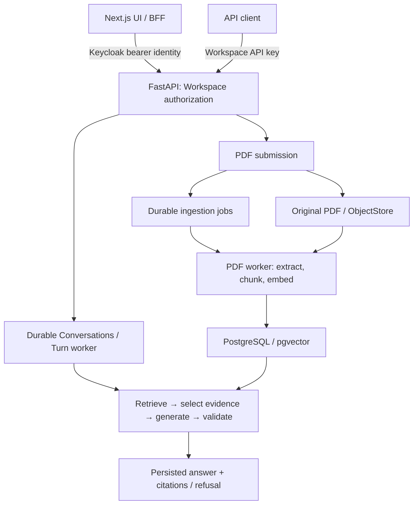

<p align="center">
  
</p>

<p align="center">
  <a href="README.md"><strong>English</strong></a> | <a href="README.vi.md">Tiếng Việt</a>
</p>

<p align="center">
  <a href="https://github.com/NhiBuaa/knora-agent/actions/workflows/ci.yml"></a>
</p>

<p align="center"><strong>Ask documents. Check the evidence.</strong></p>

<p align="center">AI-powered document Q&A with verifiable citations and evidence-based refusal.</p>

<p align="center">Knora uses retrieval-augmented generation (RAG) to answer questions from documents in a private Workspace, with cited passages you can inspect.</p>

<p align="center"><strong>Upload PDF → Ask Question → Citation / Refusal</strong></p>

> **Current status:** local PDF ingestion, Conversations and citation inspection are implemented. Answer-quality acceptance is in progress. No public demo is available.

<p align="center">
  <a href="#workflow">Workflow</a> · <a href="#engineering-highlights">Engineering Highlights</a> · <a href="#architecture">Architecture</a> · <a href="#run-locally">Run Locally</a> · <a href="#verification">Verification</a>
</p>

## Workflow


_An answer with its citation selected. The answer's “before 9 AM” statement matches the sample source. [Open the full-size screenshot](docs/assets/readme/cited-answer.jpg)._

1. **Upload a text-based PDF** to your private Workspace and wait for processing to finish.
2. **Ask a question** in a Conversation.
3. **Inspect a citation** to see the source excerpt and page, or receive an explicit refusal when evidence is insufficient.

<details>
<summary><strong>PDF upload and refusal examples</strong></summary>

### From upload to Ready


The upload creates a durable Ingestion Job. The sample reached **Ready** after worker processing.

### No supporting evidence


This question returned `INSUFFICIENT_EVIDENCE` without a generated answer or citation.

**Screenshot provenance:** recaptured on **2026-10-14** with a production frontend build from `c71d35d` and backend source tree `c78140c`. The stored answer and refusal were originally produced from `7697615`, using Cloudflare Qwen3 embeddings (`embedding-cloudflare-qwen3-06b-v1`) and GPT-OSS generation. Recapture reused those results without changing their content or making new model calls.

The answer screenshot was subsequently recaptured from the same frontend build with backend source `fe3b696`, with the conversation rail hidden. The image preserves the full viewport, including the Evidence Inspector and question composer. The stored answer and citation are unchanged.

</details>

Real local runtime using a [fictional CC0 sample PDF](docs/assets/readme/community-garden-guide.pdf). These examples are not hosted-demo or general answer-quality evidence.

## Feature Highlights


## Engineering Highlights

The backend owns authorization, document state, evidence and validated outcomes. The UI presents its public contracts.

### Durable PDF ingestion

Persisted jobs and attempts, bounded retries, lease fencing and atomic activation prevent an expired worker from publishing stale work.

[M2 specification](docs/specs/done/milestone-2-production-ingestion.md) · [PostgreSQL coordination tests](backend/test/adapters/postgres/test_ingestion_job_coordination.py)

### Traceable citations and refusal

Generation receives request-scoped evidence aliases. The server validates markers and resolves source metadata; no qualified evidence means refusal without generation. Structural validity is separate from semantic correctness.

[Answering use case](backend/src/knora/answering/module.py) · [Generation validation tests](backend/test/answering/test_generation_validation.py)

### Workspace isolation and durable Conversations

Backend ownership checks precede resource lookup. Turn admission is idempotent, execution is serialized per Conversation, and finalization is fenced.

[Ownership tests](backend/test/access/test_workspace_identity.py) · [Conversation concurrency tests](backend/test/adapters/postgres/test_conversation_concurrency.py)

### Versioned retrieval

PostgreSQL supports pgvector and full-text retrieval with versioned RRF. Workspace, active-set and embedding-profile filters apply before ranking; derivations retain provenance.

[Retrieval adapter](backend/src/knora/adapters/postgres/answering_store.py) · [Retrieval tests](backend/test/adapters/postgres/test_answering_store.py)

### Reproducible evaluation

Versioned datasets, corpus manifests and scorer/configuration provenance separate structural checks, retrieval metrics, semantic scoring and observation failures. Evaluation uses the normal Q&A HTTP seam.

[Evaluation methodology](docs/evaluation.md) · [Runner tests](evals/test/test_evaluation_runner.py)

The [human-approved tool workflow](docs/design/milestone-4-tools-human-approval.md) additionally separates approval from current execution authority and models idempotency/reconciliation. Its reference-provider evidence does not establish a live integration with an external support system.

## Architecture



**Current stack:** Python / FastAPI, PostgreSQL / pgvector, object storage, Cloudflare Workers AI, Next.js / TypeScript and Keycloak. The local launcher runs separate PDF and Conversation workers; a production deployment topology remains to be established.

For boundaries, trade-offs and failure semantics, read:

- [Architecture Standard](docs/standards/architecture.md) and [domain model](CONTEXT.md).
- [M1 application seams](docs/design/milestone-1-module-seams.md) and [M2 ingestion seams](docs/design/milestone-2-module-seams.md).
- [PostgreSQL job-store rationale](docs/adr/0001-postgresql-ingestion-job-store.md), [PDF citation provenance](docs/adr/0002-pdf-citation-provenance.md) and [fenced retry policy](docs/adr/0005-fenced-ingestion-retry-policy.md).

## Run Locally

The documented daily development path uses **Windows / PowerShell**, **Python 3.12–3.14**, **Node.js 22** and **Docker Desktop with Linux containers**. Real AI uses Cloudflare Workers AI; credentials and available allowance are required.

From a fresh checkout:

```powershell
git clone https://github.com/NhiBuaa/knora-agent.git
Set-Location knora-agent
python -m venv .venv
.\.venv\Scripts\python -m pip install -e ".\backend[dev]"
npm --prefix frontend ci
if (-not (Test-Path .env)) {
    Copy-Item .env.example .env
}
```

Follow the [local-development runbook](docs/runbooks/local-development.md#one-time-setup) to set the local MinIO credentials, random session secret and Cloudflare account/token in the ignored `.env`. Keep Docker Desktop running, then launch from the repository root:

```powershell
.\scripts\start-dev.ps1 -PreflightOnly
.\scripts\start-dev.ps1
```

Open **http://127.0.0.1:3000** and sign in using the runbook's bundled development realm. The launcher starts storage and Keycloak, migrates the development database, and runs the API, PDF worker, Conversation worker and frontend. Preflight checks configuration and safety prerequisites; it does not verify Cloudflare answers or billing.

Use the same runbook for authentication, shutdown and troubleshooting. [Ollama](docs/runbooks/local-ollama.md) is an optional offline path. Deterministic providers exercise contracts and simulated output; they do not demonstrate semantic answer quality. Do not reuse development credentials or the bundled realm for a public deployment.

## Verification

The automatic **[CI workflow](https://github.com/NhiBuaa/knora-agent/actions/workflows/ci.yml)** covers Frontend, Backend (Ubuntu and Windows), Database and Keycloak contracts, with formatting in the owning jobs. **`CI required`** aggregates these results. The badge above tracks `main`, not every PR or a deployed environment.

- **Automatic CI:** deterministic unit, fixture, adapter and integration contracts. It excludes real AI calls and application service E2E. [CI workflow](.github/workflows/ci.yml) · [CI runbook](docs/runbooks/ci.md).
- **Manual Runtime Verification:** selected isolated application or OTP journeys for the exact `subject_sha` recorded in a run's evidence. A successful run for another SHA does not qualify the current commit. [Workflow and run artifacts](https://github.com/NhiBuaa/knora-agent/actions/workflows/runtime-verification.yml) · [Release evidence checklist](docs/runbooks/ci.md#release-evidence-checklist).
- **Model-backed quality evaluation:** dataset- and configuration-scoped retrieval, answer, citation-support and refusal observations. Historical results do not establish general quality or current release acceptance. [Evaluation methodology and report index](docs/evaluation.md) · [Evaluation artifacts](evals/reports).

Local repository checks:

Database integration tests require a migrated, isolated PostgreSQL / pgvector database supplied through `KNORA_DATABASE_URL`. See the [CI database job](.github/workflows/ci.yml) for its setup; use a test database, separate from your application data.

```powershell
.\.venv\Scripts\python -m pytest
.\.venv\Scripts\ruff check .
docker compose config --quiet
npm --prefix frontend run format:shared:check
```

These checks and the screenshots do not establish public availability, production readiness or semantic correctness for arbitrary questions.

## Current Scope and Limitations

- **Implemented:** cited document Q&A, durable text-based PDF ingestion, versioned PostgreSQL retrieval, private Workspaces, durable Conversations, citation inspection and operator projections. M4 tool contracts require explicit integration composition.
- **Active work:** [Retrieval V3 / Qdrant-first upgrade (#153)](https://github.com/NhiBuaa/knora-agent/issues/153) and [DeepEval / Langfuse integration (#158)](https://github.com/NhiBuaa/knora-agent/issues/158). Target designs and installed tools are not quality acceptance.
- **Public availability:** [Public Demo (#181)](https://github.com/NhiBuaa/knora-agent/issues/181) waits for #153/#158 and owner acceptance of release-candidate quality evidence. No live demo, production operation, user adoption or performance claim is made here.
- **Input and quality limits:** the PDF path requires extractable text. OCR and perfect complex-layout recovery are not promised. Valid citation structure does not guarantee that an answer is semantically supported; remaining quality errors are being evaluated.
- **Future integration:** KittaChat × Knora remains planned, not implemented. Progress and technical decisions live in the [GitHub Project](https://github.com/users/NhiBuaa/projects/5) and linked Issues.

## Ownership

Knora is an individual portfolio project maintained by NhiBuaa, developed with AI assistance.
