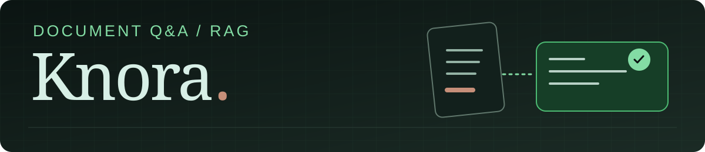
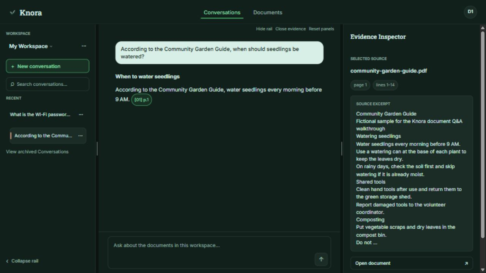
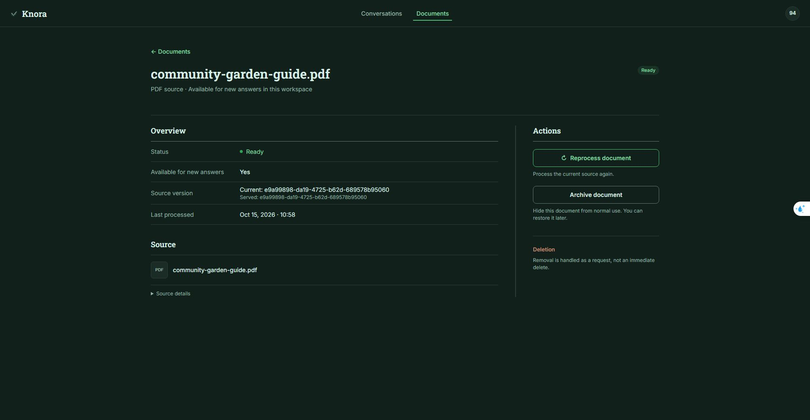
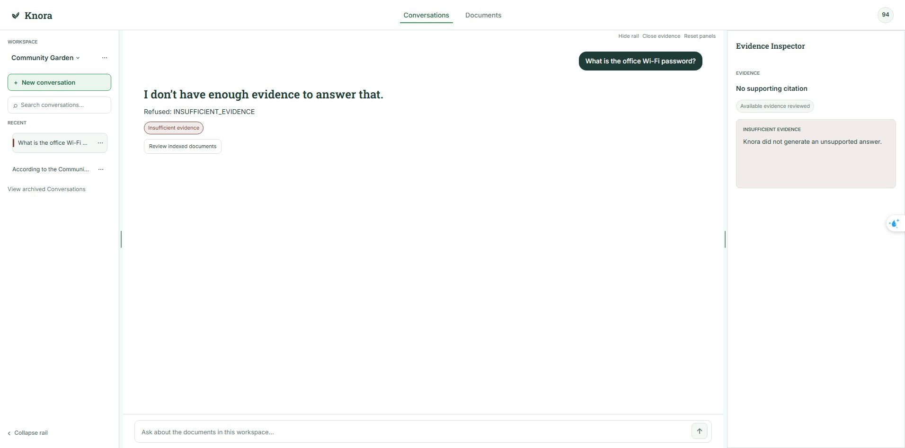
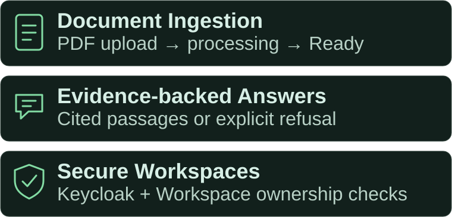
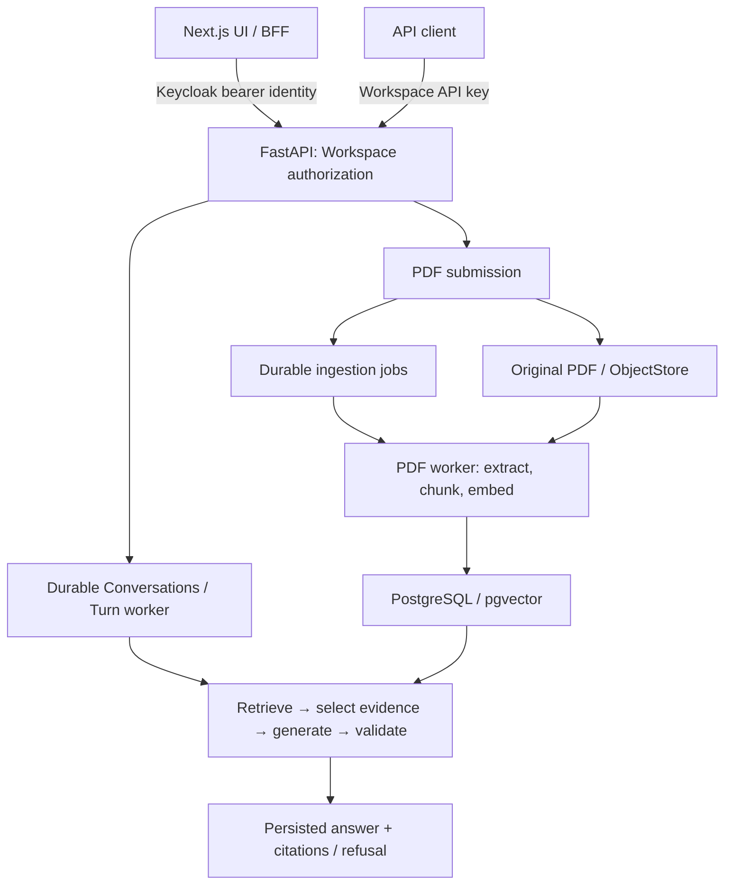

<p align="center">
  
</p>

<p align="center">
  <a href="README.md">English</a> | <a href="README.vi.md"><strong>Tiếng Việt</strong></a>
</p>

<p align="center">
  <a href="https://github.com/NhiBuaa/knora-agent/actions/workflows/ci.yml"></a>
</p>

<p align="center"><strong>Hỏi tài liệu. Kiểm tra bằng chứng.</strong></p>

<p align="center">Hỏi đáp tài liệu bằng AI, với trích dẫn có thể kiểm chứng và khả năng từ chối trả lời khi không đủ bằng chứng.</p>

<p align="center">Knora sử dụng retrieval-augmented generation (RAG) để trả lời câu hỏi từ tài liệu trong Workspace riêng tư, kèm các đoạn trích dẫn có thể kiểm tra.</p>

<p align="center"><strong>Upload PDF → Đặt câu hỏi → Trích dẫn / Từ chối</strong></p>

> **Trạng thái hiện tại:** đã triển khai PDF ingestion cục bộ, Conversations và kiểm tra trích dẫn. Việc nghiệm thu chất lượng câu trả lời đang diễn ra. Chưa có public demo.

<p align="center">
  <a href="#quy-trình-sử-dụng">Quy trình sử dụng</a> · <a href="#điểm-nổi-bật-kỹ-thuật">Điểm nổi bật kỹ thuật</a> · <a href="#kiến-trúc">Kiến trúc</a> · <a href="#chạy-cục-bộ">Chạy cục bộ</a> · <a href="#kiểm-chứng">Kiểm chứng</a>
</p>

## Quy trình sử dụng



_Câu trả lời với trích dẫn đang được chọn. Nội dung “before 9 AM” trong câu trả lời khớp với tài liệu mẫu. [Mở screenshot ở kích thước gốc](docs/assets/readme/cited-answer.jpg)._

1. **Upload PDF có văn bản** vào Workspace riêng tư và chờ xử lý hoàn tất.
2. **Đặt câu hỏi** trong một Conversation.
3. **Kiểm tra trích dẫn** để xem đoạn nguồn và số trang, hoặc nhận thông báo từ chối rõ ràng khi không đủ bằng chứng.

<details>
<summary><strong>Ví dụ upload PDF và từ chối trả lời</strong></summary>

### Từ upload đến Ready



Upload tạo một Ingestion Job được lưu bền vững. Tài liệu mẫu đạt trạng thái **Ready** sau khi worker xử lý. [Mở screenshot ở kích thước gốc](docs/assets/readme/pdf-upload.jpg).

### Không có bằng chứng hỗ trợ



Câu hỏi này trả về `INSUFFICIENT_EVIDENCE`, không tạo câu trả lời hoặc trích dẫn. [Mở screenshot ở kích thước gốc](docs/assets/readme/refusal.jpg).

**Nguồn gốc screenshots:** chụp ngày **2026-10-14**. Screenshot câu trả lời sử dụng production frontend build `c71d35d` với backend source `7c8d19b`; screenshots Ready và từ chối sử dụng development runtime source `96a6379`, với Dev Tools được ẩn bằng tùy chọn có sẵn cho phiên làm việc. Các capture giữ toàn bộ giao diện, không cắt hoặc chỉnh nội dung sản phẩm.

Câu trả lời và thông báo từ chối đã lưu được tạo ban đầu từ `7697615`, sử dụng Cloudflare Qwen3 embeddings (`embedding-cloudflare-qwen3-06b-v1`) và GPT-OSS generation. Lần chụp lại sử dụng các kết quả đó, không thay đổi nội dung hoặc gọi model mới.

</details>

Runtime cục bộ thật sử dụng [PDF mẫu hư cấu CC0](docs/assets/readme/community-garden-guide.pdf). Các ví dụ này không phải bằng chứng về hosted demo hoặc chất lượng câu trả lời tổng quát.

## Điểm nổi bật sản phẩm



## Điểm nổi bật kỹ thuật

Backend quản lý authorization, trạng thái tài liệu, bằng chứng và kết quả đã được kiểm tra. UI trình bày các public contracts của backend.

### PDF ingestion bền vững

Jobs và attempts được lưu bền vững, số lần retry có giới hạn, lease fencing và atomic activation ngăn worker đã hết lease công bố kết quả cũ.

[Đặc tả M2](docs/specs/done/milestone-2-production-ingestion.md) · [Tests điều phối PostgreSQL](backend/test/adapters/postgres/test_ingestion_job_coordination.py)

### Trích dẫn và từ chối có thể truy vết

Generation nhận các evidence aliases giới hạn trong từng request. Server kiểm tra markers và phân giải metadata nguồn; khi không có bằng chứng đạt yêu cầu, hệ thống từ chối mà không gọi generation. Tính hợp lệ về cấu trúc được phân biệt với tính đúng đắn về ngữ nghĩa.

[Answering use case](backend/src/knora/answering/module.py) · [Tests kiểm tra generation](backend/test/answering/test_generation_validation.py)

### Cô lập Workspace và Conversations bền vững

Backend kiểm tra ownership trước khi tra cứu tài nguyên. Turn admission có tính idempotent, việc thực thi được tuần tự hóa theo từng Conversation và finalization được bảo vệ bằng fencing.

[Tests ownership](backend/test/access/test_workspace_identity.py) · [Tests concurrency của Conversation](backend/test/adapters/postgres/test_conversation_concurrency.py)

### Retrieval có quản lý phiên bản

PostgreSQL hỗ trợ pgvector và full-text retrieval với RRF có quản lý phiên bản. Bộ lọc Workspace, active-set và embedding-profile được áp dụng trước ranking; các derivations giữ thông tin nguồn gốc.

[Retrieval adapter](backend/src/knora/adapters/postgres/answering_store.py) · [Tests retrieval](backend/test/adapters/postgres/test_answering_store.py)

### Evaluation có thể tái lập

Datasets có quản lý phiên bản, corpus manifests và nguồn gốc scorer/configuration giúp phân biệt kiểm tra cấu trúc, retrieval metrics, semantic scoring và observation failures. Evaluation sử dụng Q&A HTTP seam thông thường.

[Phương pháp evaluation](docs/evaluation.md) · [Tests runner](evals/test/test_evaluation_runner.py)

[Workflow công cụ cần con người phê duyệt](docs/design/milestone-4-tools-human-approval.md) còn tách biệt phê duyệt với quyền thực thi hiện tại và mô hình hóa idempotency/reconciliation. Bằng chứng từ reference provider không chứng minh tích hợp đang hoạt động với hệ thống hỗ trợ bên ngoài.

## Kiến trúc



**Stack hiện tại:** Python / FastAPI, PostgreSQL / pgvector, object storage, Cloudflare Workers AI, Next.js / TypeScript và Keycloak. Launcher cục bộ chạy PDF worker và Conversation worker riêng; topology triển khai production chưa được xác lập.

Đọc thêm về ranh giới hệ thống, trade-offs và failure semantics:

- [Architecture Standard](docs/standards/architecture.md) và [domain model](CONTEXT.md).
- [M1 application seams](docs/design/milestone-1-module-seams.md) và [M2 ingestion seams](docs/design/milestone-2-module-seams.md).
- [Lý do chọn PostgreSQL job store](docs/adr/0001-postgresql-ingestion-job-store.md), [nguồn gốc trích dẫn PDF](docs/adr/0002-pdf-citation-provenance.md) và [fenced retry policy](docs/adr/0005-fenced-ingestion-retry-policy.md).

## Chạy cục bộ

Hướng phát triển hằng ngày được tài liệu hóa sử dụng **Windows / PowerShell**, **Python 3.12–3.14**, **Node.js 22** và **Docker Desktop với Linux containers**. AI thật sử dụng Cloudflare Workers AI; cần credentials và hạn mức khả dụng.

Từ checkout mới:

```powershell
git clone https://github.com/NhiBuaa/knora-agent.git
Set-Location knora-agent
python -m venv .venv
.\.venv\Scripts\python -m pip install -e ".\backend[dev]"
npm --prefix frontend ci
if (-not (Test-Path .env)) {
    Copy-Item .env.example .env
}
```

Nếu đã có checkout hoặc vừa mở cửa sổ PowerShell mới, trước tiên vào thư mục repository của bạn (thay đường dẫn ví dụ):

```powershell
Set-Location "C:\path\to\knora-agent"
Test-Path .\scripts\start-dev.ps1
```

`Test-Path` phải trả về `True`. Lỗi “not recognized” / `CommandNotFoundException` nghĩa là PowerShell không tìm thấy script ở đường dẫn đã nhập; hãy kiểm tra thư mục hiện tại.

Nếu PowerShell báo việc chạy scripts bị vô hiệu hóa, cho phép chạy local scripts trong phiên hiện tại, rồi xác nhận nếu có lời nhắc:

```powershell
Set-ExecutionPolicy -Scope Process -ExecutionPolicy RemoteSigned
```

Thiết lập này hết hiệu lực khi đóng cửa sổ PowerShell; Group Policy của tổ chức có thể ghi đè. Xem [tài liệu execution policy của Microsoft](https://learn.microsoft.com/en-us/powershell/module/microsoft.powershell.security/set-executionpolicy).

Làm theo [runbook phát triển cục bộ](docs/runbooks/local-development.md#one-time-setup) để đặt MinIO credentials cục bộ, session secret ngẫu nhiên và Cloudflare account/token trong `.env` được Git bỏ qua. Giữ Docker Desktop đang chạy, sau đó khởi động từ cùng thư mục repository đó:

```powershell
.\scripts\start-dev.ps1 -PreflightOnly
.\scripts\start-dev.ps1
```

Mở **http://127.0.0.1:3000** và đăng nhập bằng development realm đi kèm được mô tả trong runbook. Launcher khởi động storage và Keycloak, chạy migration cho database phát triển, rồi chạy API, PDF worker, Conversation worker và frontend. Preflight kiểm tra cấu hình và điều kiện an toàn; không kiểm chứng câu trả lời Cloudflare hoặc billing.

Dùng cùng runbook cho authentication, shutdown và troubleshooting. [Ollama](docs/runbooks/local-ollama.md) là lựa chọn offline tùy chọn. Deterministic providers kiểm tra contracts và output mô phỏng; không chứng minh chất lượng ngữ nghĩa của câu trả lời. Không tái sử dụng development credentials hoặc realm đi kèm cho public deployment.

## Kiểm chứng

**[CI workflow](https://github.com/NhiBuaa/knora-agent/actions/workflows/ci.yml)** tự động kiểm tra contracts của Frontend, Backend (Ubuntu và Windows), Database và Keycloak, cùng formatting trong các jobs tương ứng. **`CI required`** tổng hợp các kết quả này. Badge phía trên theo dõi `main`, không đại diện cho mọi PR hoặc môi trường đã deploy.

- **CI tự động:** các deterministic unit, fixture, adapter và integration contracts. Không bao gồm AI calls thật hoặc application service E2E. [CI workflow](.github/workflows/ci.yml) · [CI runbook](docs/runbooks/ci.md).
- **Runtime Verification thủ công:** các application hoặc OTP journeys cô lập được chọn, cho đúng `subject_sha` ghi trong evidence của run. Run thành công cho SHA khác không xác nhận commit hiện tại. [Workflow và run artifacts](https://github.com/NhiBuaa/knora-agent/actions/workflows/runtime-verification.yml) · [Release evidence checklist](docs/runbooks/ci.md#release-evidence-checklist).
- **Evaluation chất lượng có gọi model:** các quan sát về retrieval, câu trả lời, citation support và refusal giới hạn theo dataset/configuration. Kết quả lịch sử không chứng minh chất lượng tổng quát hoặc nghiệm thu release hiện tại. [Phương pháp evaluation và danh mục báo cáo](docs/evaluation.md) · [Evaluation artifacts](evals/reports).

Kiểm tra repository cục bộ:

Database integration tests cần PostgreSQL / pgvector cô lập đã migration, được cung cấp qua `KNORA_DATABASE_URL`. Xem cách thiết lập trong [CI database job](.github/workflows/ci.yml); dùng database kiểm thử tách biệt với dữ liệu ứng dụng.

```powershell
.\.venv\Scripts\python -m pytest
.\.venv\Scripts\ruff check .
docker compose config --quiet
npm --prefix frontend run format:shared:check
```

Các kiểm tra này và screenshots không chứng minh public availability, production readiness hoặc tính đúng đắn về ngữ nghĩa cho mọi câu hỏi.

## Phạm vi hiện tại và giới hạn

- **Đã triển khai:** hỏi đáp tài liệu có trích dẫn, PDF ingestion bền vững cho tài liệu có văn bản, PostgreSQL retrieval có quản lý phiên bản, Workspaces riêng tư, Conversations bền vững, kiểm tra trích dẫn và operator projections. M4 tool contracts cần integration composition tường minh.
- **Đang thực hiện:** [nâng cấp Retrieval V3 / Qdrant-first (#153)](https://github.com/NhiBuaa/knora-agent/issues/153) và [tích hợp DeepEval / Langfuse (#158)](https://github.com/NhiBuaa/knora-agent/issues/158). Target designs và công cụ đã cài không tương đương với nghiệm thu chất lượng.
- **Public availability:** [Public Demo (#181)](https://github.com/NhiBuaa/knora-agent/issues/181) chờ #153/#158 và chủ dự án nghiệm thu bằng chứng chất lượng release candidate. README không tuyên bố đã có live demo, vận hành production, người dùng thực tế hoặc hiệu năng.
- **Giới hạn input và chất lượng:** PDF phải có văn bản trích xuất được. Không cam kết OCR hoặc khôi phục hoàn hảo bố cục phức tạp. Cấu trúc trích dẫn hợp lệ không bảo đảm câu trả lời được hỗ trợ về ngữ nghĩa; các lỗi chất lượng còn lại đang được đánh giá.
- **Tích hợp tương lai:** KittaChat × Knora vẫn là kế hoạch, chưa triển khai. Tiến độ và quyết định kỹ thuật nằm trong [GitHub Project](https://github.com/users/NhiBuaa/projects/5) và các Issues liên quan.

## Ownership

Knora là dự án portfolio cá nhân do NhiBuaa duy trì, được phát triển với sự hỗ trợ của AI.
