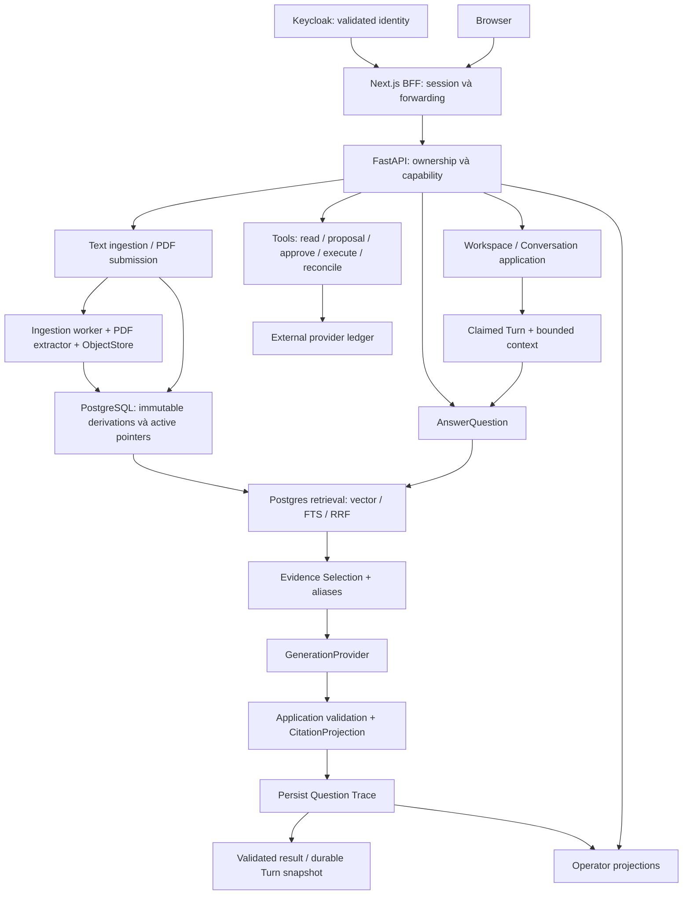

# Research: kiến trúc hiện tại và các boundary của Knora

Ngày khảo sát: **2026-10-05**, múi giờ **Asia/Saigon**.  
Phạm vi: answering, ingestion, retrieval, evidence, generation, Conversations, tools, auth,
Operator, provider ports, quyền sở hữu DB và tình trạng issue.

## 1. Kết luận chính

**Knora có nền tảng tốt về tính đúng đắn, quyền sở hữu và khả năng truy vết. Điểm đang chật là
sự giao nhau giữa answering, trace, phục hồi Conversation, evaluation và cấu hình model.**
Hướng refactor đáng cân nhắc là làm rõ interface và ownership ở các giao điểm này; chưa có
bằng chứng trong khảo sát buộc thay PostgreSQL/pgvector, thêm framework agent hoặc chia microservice.

Ba điểm mạnh nên bảo toàn:

1. Workspace là tenant boundary; Keycloak chứng minh issuer/subject, Knora DB chứng minh
   ownership. Browser preference và JWT Workspace claims không quyết định quyền truy cập.
2. Source revision, chunk derivation và embedding derivation có identity riêng; active pointer,
   CAS, lease/fencing và transaction bảo vệ việc xuất bản kết quả.
3. Generation trả dữ liệu có cấu trúc; application sở hữu Evidence Alias, validation và citation.
   Human approval của tool tách biệt với execution authority và provider outcome truth.

Nguồn: [ownership và quan hệ domain](https://github.com/NhiBuaa/knora-agent/blob/ee7572583d558676c6d75ed266cc4a1f4fe0286d/CONTEXT.md#L7),
[activation/concurrency](https://github.com/NhiBuaa/knora-agent/blob/ee7572583d558676c6d75ed266cc4a1f4fe0286d/docs/standards/architecture.md#L142),
[application seams](https://github.com/NhiBuaa/knora-agent/blob/ee7572583d558676c6d75ed266cc4a1f4fe0286d/docs/design/milestone-1-module-seams.md#L5),
[tool authority](https://github.com/NhiBuaa/knora-agent/blob/ee7572583d558676c6d75ed266cc4a1f4fe0286d/docs/adr/0015-human-approved-tool-execution-boundary.md#L5).

Các điểm cần ưu tiên đối chiếu trước khi refactor:

- Operator đọc trace qua reader dành cho evaluation, nên đang gắn với active corpus hiện tại.
- `AnsweringStore` gộp retrieval, trace write và Conversation recovery; citation được dựng
  ở cả application lẫn PostgreSQL adapter.
- DB I/O đồng bộ vẫn chạy trực tiếp trong `async AnswerQuestion`.
- Shared generation schema đã có, nhưng một phần grounding behavior và model policy vẫn
  nằm trong transport adapter Ollama.
- Code profile-sized vectors đã phát triển vượt mô tả toàn cục `vector(1536)` trong standard.
- Một số đường legacy và adapter nằm ngoài ownership directory được mô tả trong seams.

Đây là kết luận từ source inspection. Các rủi ro performance, trace lịch sử và nhiều replica
chưa được tái hiện bằng runtime trong lượt nghiên cứu này; chi tiết và nguồn nằm ở mục 5.

## 2. Baseline và cách đọc bằng chứng

| Hạng mục | Snapshot được khảo sát |
| --- | --- |
| Checkout | `C:/Developer/Projects/knora-agent`, branch `codex/test` |
| Local HEAD | `7102d45fe084b9b8850a1cbc54a861a34690d12b` |
| GitHub main / fetched origin/main | `ee7572583d558676c6d75ed266cc4a1f4fe0286d` |
| Local main | `ea7b7e23ac193091e724bce755cec3961bc1c7c2`; chưa đồng bộ với remote main tại thời điểm khảo sát |
| Source equivalence | `git diff origin/main HEAD` chỉ khác 10 file tài liệu/kế hoạch, 3018 dòng thêm; backend, frontend, evals và cấu hình không khác |
| GitHub snapshot | Kiểm tra lại lúc khoảng **18:54 ngày 2026-10-05**: **0 issue mở, 0 PR mở** |
| Working tree lúc bắt đầu | Sạch |

Các link source trong báo cáo pin vào **GitHub main SHA ở trên**; code tương ứng với checkout
được đọc. Số commit riêng giữa hai branch không được dùng làm thước đo độ lệch kiến trúc:
tree diff cho thấy khác biệt hiện tại chỉ ở tài liệu.

Phương pháp: đọc source và protocol, đối chiếu `CONTEXT.md`, Architecture Standard, M1/M2
Module Seams và ADR; đọc issue body **và comments**, PR checkpoint và artifact evaluation;
quét AST import direction để phát hiện concrete adapter/ORM trong application modules.
GitHub được đọc qua `gh` và REST API theo [tracker guide](https://github.com/NhiBuaa/knora-agent/blob/ee7572583d558676c6d75ed266cc4a1f4fe0286d/docs/agents/issue-tracker.md#L1).

Phân biệt bốn loại bằng chứng:

- **Quan sát code:** implementation hoặc dependency thực sự có trong snapshot.
- **Quy định:** behavior/ownership được tài liệu normative yêu cầu.
- **Bằng chứng đã ghi nhận:** kết quả lịch sử trong PR/artifact, có source/config riêng.
- **Suy luận hoặc khoảng trống:** cần characterization, benchmark hoặc acceptance mới.

Lượt này chỉ thêm báo cáo Markdown; không thực thi refactor, thay cấu hình runtime, migration,
commit/push hoặc cập nhật GitHub. Không chạy full pytest, live model, browser acceptance hay load
test; sự tồn tại của test không đồng nghĩa test vừa chạy PASS. Các đề xuất dưới đây là ứng viên
để thiết kế tiếp, không phải quyết định domain hay implementation plan đã được duyệt.

## 3. Luồng hệ thống hiện tại

### 3.1. Luồng dữ liệu và authority

Sơ đồ chỉ thể hiện các luồng đang có; không có cạnh model tự động chọn tool.
Nguồn: [composition](https://github.com/NhiBuaa/knora-agent/blob/ee7572583d558676c6d75ed266cc4a1f4fe0286d/backend/src/knora/main.py#L158),
[Q&A orchestration](https://github.com/NhiBuaa/knora-agent/blob/ee7572583d558676c6d75ed266cc4a1f4fe0286d/backend/src/knora/answering/module.py#L100),
[Turn execution](https://github.com/NhiBuaa/knora-agent/blob/ee7572583d558676c6d75ed266cc4a1f4fe0286d/backend/src/knora/conversations/runner.py#L50),
[approved tool execution](https://github.com/NhiBuaa/knora-agent/blob/ee7572583d558676c6d75ed266cc4a1f4fe0286d/backend/src/knora/tools/execution.py#L125).

### 3.2. Bản đồ module và interface

| Vùng | Owner và interface hiện tại | Đánh giá |
| --- | --- | --- |
| `answering/` | `AnswerQuestion.execute(command, principal)`; runtime pipeline, evidence, validation, configuration; cùng package còn chứa calibration/re-embedding/cutover | External seam sâu và hữu ích; namespace chứa nhiều lifecycle khác nhau |
| Ingestion | `IngestDocument` cho text; `IngestionJobs` cho PDF submit/status/reprocess; `ProcessIngestionJob` cho worker; lifecycle cleanup riêng | Tách theo use case và transaction tốt |
| Retrieval | `AnsweringStore.retrieve_candidates`; Postgres sở hữu SQL, vector/FTS branch, filtering, rank và fusion | Application không phải biết nhánh search; khả năng đổi storage cần giữ provenance/activation semantics |
| Evidence | Pure `select_evidence(candidates, configuration)` | Locality tốt; policy thay đổi có version, không sửa baseline âm thầm |
| Generation | `GenerationProvider.generate(question, evidence)` → `GenerationResult`; application validate và resolve citation | Port nhỏ; prompt behavior theo model còn gần transport |
| Conversations | Service admission/lifecycle; store durable Turn; runner claim/heartbeat/recovery; context policy riêng | Không dùng chat history làm evidence; recovery đã có consumer-owned reader |
| Tools | Typed capability/reference, read gateway, proposal/approval, execution và reconciliation | Authority mạnh; chưa có model-decision bridge trong Q&A |
| Auth / Workspaces | Identity issuer/sub, persisted ownership, capabilities và Workspace mutation admission | Phân biệt authentication/authorization rõ; BFF refresh có topology limit |
| Operator | Workspace/capability-guarded projections cho trace, operations và evaluation-unavailable | Safe read seam; trace reader còn chịu assumptions của evaluator |
| Provider ports | Embedding configuration/profile, document/query roles; generation structured output | Có nhiều adapter thật; compatibility fallback và lifecycle còn phân tán |
| DB ownership | Một Knora PostgreSQL registry và migrations; transaction-shaped stores theo application consumer | Chưa có lý do chia DB; legacy registry làm navigation dễ nhầm |

Nguồn interface: [Q&A commands/results](https://github.com/NhiBuaa/knora-agent/blob/ee7572583d558676c6d75ed266cc4a1f4fe0286d/backend/src/knora/answering/interface.py#L17),
[PDF application](https://github.com/NhiBuaa/knora-agent/blob/ee7572583d558676c6d75ed266cc4a1f4fe0286d/backend/src/knora/ingestion/jobs.py#L229),
[worker store port](https://github.com/NhiBuaa/knora-agent/blob/ee7572583d558676c6d75ed266cc4a1f4fe0286d/backend/src/knora/ingestion/job_processing.py#L906),
[AnsweringStore](https://github.com/NhiBuaa/knora-agent/blob/ee7572583d558676c6d75ed266cc4a1f4fe0286d/backend/src/knora/answering/stores.py#L254),
[Conversation ports](https://github.com/NhiBuaa/knora-agent/blob/ee7572583d558676c6d75ed266cc4a1f4fe0286d/backend/src/knora/conversations/ports.py#L17),
[EmbeddingProvider](https://github.com/NhiBuaa/knora-agent/blob/ee7572583d558676c6d75ed266cc4a1f4fe0286d/backend/src/knora/providers/embedding.py#L73),
[GenerationProvider](https://github.com/NhiBuaa/knora-agent/blob/ee7572583d558676c6d75ed266cc4a1f4fe0286d/backend/src/knora/providers/generation.py#L26).

### 3.3. Provider ports và adapter hiện có

| Port | Adapter được compose hiện tại | Semantics cần giữ |
| --- | --- | --- |
| EmbeddingProvider | Deterministic-local, OpenAI-compatible, Gemini native API, Ollama | Document/query roles có thể asymmetric; immutable configuration và dimension/profile identity |
| GenerationProvider | Deterministic-local, OpenAI-compatible, Ollama Qwen/GPT-OSS | Structured answer/refusal; transport/model controls và prompt version có provenance riêng |
| ObjectStore | Filesystem hoặc S3-compatible | Streaming, opaque key, Workspace isolation và external-delete reconciliation |
| SupportToolGateway | Fake test adapter hoặc SQLite reference gateway khi được inject | External idempotency/outcome truth, scope-bound resource, typed uncertainty |

Nguồn: [provider selection](https://github.com/NhiBuaa/knora-agent/blob/ee7572583d558676c6d75ed266cc4a1f4fe0286d/backend/src/knora/bootstrap.py#L28),
[storage composition](https://github.com/NhiBuaa/knora-agent/blob/ee7572583d558676c6d75ed266cc4a1f4fe0286d/backend/src/knora/main.py#L185),
[tool gateway implementations](https://github.com/NhiBuaa/knora-agent/blob/ee7572583d558676c6d75ed266cc4a1f4fe0286d/backend/src/knora/tools/gateway.py#L155).
Cloudflare provider/guest demo không xuất hiện trong composition đã khảo sát; các issue kế hoạch
liên quan ở mục 7 đã đóng not_planned. Không coi provider probe hoặc reference tool provider
là bằng chứng integration với dịch vụ production bên ngoài đã nghiệm thu.

## 4. Những boundary hiện mạnh

### 4.1. Ingestion → persisted derivation → retrieval

Text processing, embedding và vector validation diễn ra trước `commit_derivation`; store
sở hữu transaction/CAS. PDF có submission, processing, extractor và object lifecycle riêng,
không đẩy tất cả format vào `IngestDocument`. Source object thuộc Document Version và cleanup
không đảo ngược kết quả ingestion đã durable.
Nguồn: [text use case](https://github.com/NhiBuaa/knora-agent/blob/ee7572583d558676c6d75ed266cc4a1f4fe0286d/backend/src/knora/ingestion/module.py#L41),
[commit transaction](https://github.com/NhiBuaa/knora-agent/blob/ee7572583d558676c6d75ed266cc4a1f4fe0286d/backend/src/knora/adapters/postgres/ingestion_store.py#L48),
[PDF/worker seams](https://github.com/NhiBuaa/knora-agent/blob/ee7572583d558676c6d75ed266cc4a1f4fe0286d/docs/design/milestone-2-module-seams.md#L17),
[source-object retention](https://github.com/NhiBuaa/knora-agent/blob/ee7572583d558676c6d75ed266cc4a1f4fe0286d/docs/adr/0006-document-version-owned-source-objects.md#L1).

Claimed attempt, operation IDs, failure cause và retry policy có kiểu riêng; DB time quyết định
lease, monotonic clock quyết định elapsed runtime. Claim/provider latency không cùng transaction.
`PostgresIngestionJobStore` đã phân rã nội bộ theo submission, coordination, lifecycle; facade
tương thích còn lại là quyết định đã được duyệt, không phải dấu hiệu bắt buộc tách tiếp.
Nguồn: [supervisor](https://github.com/NhiBuaa/knora-agent/blob/ee7572583d558676c6d75ed266cc4a1f4fe0286d/backend/src/knora/ingestion/job_processing.py#L836),
[run-once orchestration](https://github.com/NhiBuaa/knora-agent/blob/ee7572583d558676c6d75ed266cc4a1f4fe0286d/backend/src/knora/ingestion/job_processing.py#L988),
[facade composition](https://github.com/NhiBuaa/knora-agent/blob/ee7572583d558676c6d75ed266cc4a1f4fe0286d/backend/src/knora/adapters/postgres/ingestion_job_store.py#L55),
[accepted decomposition design](https://github.com/NhiBuaa/knora-agent/blob/ee7572583d558676c6d75ed266cc4a1f4fe0286d/docs/design/postgres-ingestion-job-store-refactor.md#L1).

**Giới hạn cần biết:** thread detach không đồng nghĩa kill provider I/O; capacity và external
idempotency vẫn cần được giữ. PDF extractor process isolation là một seam khác.
Nguồn: [execution mechanics và detach](https://github.com/NhiBuaa/knora-agent/blob/ee7572583d558676c6d75ed266cc4a1f4fe0286d/docs/standards/architecture.md#L359),
[PDF process budget](https://github.com/NhiBuaa/knora-agent/blob/ee7572583d558676c6d75ed266cc4a1f4fe0286d/docs/standards/architecture.md#L606).

### 4.2. Retrieval → Evidence Selection

Postgres áp dụng Workspace, active-set, embedding-profile và archive predicates trong search,
không retrieve toàn cục rồi lọc ngoài application. Vector và FTS chạy trong một retrieval seam,
với `REPEATABLE READ`, deterministic order và versioned RRF. Fusion score được coi là rank,
không tự biến thành confidence threshold.
Nguồn: [retrieval snapshot](https://github.com/NhiBuaa/knora-agent/blob/ee7572583d558676c6d75ed266cc4a1f4fe0286d/backend/src/knora/adapters/postgres/answering_store.py#L64),
[vector predicates](https://github.com/NhiBuaa/knora-agent/blob/ee7572583d558676c6d75ed266cc4a1f4fe0286d/backend/src/knora/adapters/postgres/answering_store.py#L223),
[FTS branch](https://github.com/NhiBuaa/knora-agent/blob/ee7572583d558676c6d75ed266cc4a1f4fe0286d/backend/src/knora/adapters/postgres/answering_store.py#L370),
[fusion](https://github.com/NhiBuaa/knora-agent/blob/ee7572583d558676c6d75ed266cc4a1f4fe0286d/backend/src/knora/adapters/postgres/answering_store.py#L502),
[score semantics](https://github.com/NhiBuaa/knora-agent/blob/ee7572583d558676c6d75ed266cc4a1f4fe0286d/docs/standards/architecture.md#L650).

Evidence Selection là pure function, có count/token budgets và decision provenance.
Containment policy bảo toàn thứ tự, case và punctuation; partial overlap không tự loại bỏ chunk
có unique facts. Legacy overlap policy vẫn tồn tại với identity riêng.
Nguồn: [redundancy policies](https://github.com/NhiBuaa/knora-agent/blob/ee7572583d558676c6d75ed266cc4a1f4fe0286d/backend/src/knora/answering/evidence.py#L24),
[selection](https://github.com/NhiBuaa/knora-agent/blob/ee7572583d558676c6d75ed266cc4a1f4fe0286d/backend/src/knora/answering/evidence.py#L44),
[immutable configurations](https://github.com/NhiBuaa/knora-agent/blob/ee7572583d558676c6d75ed266cc4a1f4fe0286d/backend/src/knora/answering/stores.py#L38).

**Giới hạn:** chưa thấy reranker, query decomposition hay graph retrieval trong runtime pipeline
đã khảo sát. SQL đang xếp hạng trực tiếp bằng cosine distance; khảo sát chưa đo corpus size,
query plan hay p95 để kết luận exact retrieval là bottleneck.
Nguồn: [pipeline](https://github.com/NhiBuaa/knora-agent/blob/ee7572583d558676c6d75ed266cc4a1f4fe0286d/backend/src/knora/answering/module.py#L111),
[distance query](https://github.com/NhiBuaa/knora-agent/blob/ee7572583d558676c6d75ed266cc4a1f4fe0286d/backend/src/knora/adapters/postgres/answering_store.py#L223).

### 4.3. Generation → validation → public citations

Provider nhận opaque aliases và content, không nhận database Chunk IDs. Application kiểm tra
structured decision, marker syntax/membership/order, rồi tự dựng version/page/offset citation.
Invalid output khác Refusal; final response chỉ xuất bản sau trace persistence.
Nguồn: [provider evidence](https://github.com/NhiBuaa/knora-agent/blob/ee7572583d558676c6d75ed266cc4a1f4fe0286d/backend/src/knora/providers/generation.py#L6),
[mechanical validator](https://github.com/NhiBuaa/knora-agent/blob/ee7572583d558676c6d75ed266cc4a1f4fe0286d/backend/src/knora/answering/generation_validation.py#L21),
[validated result](https://github.com/NhiBuaa/knora-agent/blob/ee7572583d558676c6d75ed266cc4a1f4fe0286d/backend/src/knora/answering/module.py#L265),
[citation projection](https://github.com/NhiBuaa/knora-agent/blob/ee7572583d558676c6d75ed266cc4a1f4fe0286d/backend/src/knora/answering/module.py#L382).

Shared schema/prompt đã được trích ra `providers/structured_generation.py`, nên nhận định
“mọi prompt đều nằm trong OpenAI adapter” không còn đúng.
**Validation cấu trúc không chứng minh answer đúng nghĩa hay citation faithful**; semantic quality
vẫn cần evaluation. Nguồn: [shared contract](https://github.com/NhiBuaa/knora-agent/blob/ee7572583d558676c6d75ed266cc4a1f4fe0286d/backend/src/knora/providers/structured_generation.py#L5),
[structural vs semantic correctness](https://github.com/NhiBuaa/knora-agent/blob/ee7572583d558676c6d75ed266cc4a1f4fe0286d/docs/standards/architecture.md#L758).

### 4.4. Conversations → Q&A

Turn admission gắn với original question và idempotency fingerprint; runner không giữ DB lock
khi generation. History bị chặn theo Conversation/Workspace, tối đa bốn Turn và 2048 context
tokens; self-contained retrieval dùng current question, reference follow-up dùng nearest topic
anchor. Prior assistant answers chỉ là untrusted context, không trở thành retrieval evidence.
Nguồn: [Turn admission](https://github.com/NhiBuaa/knora-agent/blob/ee7572583d558676c6d75ed266cc4a1f4fe0286d/backend/src/knora/conversations/service.py#L125),
[context limits](https://github.com/NhiBuaa/knora-agent/blob/ee7572583d558676c6d75ed266cc4a1f4fe0286d/backend/src/knora/conversations/context.py#L12),
[reference policy](https://github.com/NhiBuaa/knora-agent/blob/ee7572583d558676c6d75ed266cc4a1f4fe0286d/backend/src/knora/conversations/context.py#L122),
[claimed Turn execution](https://github.com/NhiBuaa/knora-agent/blob/ee7572583d558676c6d75ed266cc4a1f4fe0286d/backend/src/knora/conversations/runner.py#L50).

Runner đã inject `ConversationResultReader` riêng; recovery đọc committed result rồi áp dụng
fenced recovery, không tự gọi lại provider. **Không có private access vào
`answer_question._store` trong runner hiện tại.**
Nguồn: [recovery reader](https://github.com/NhiBuaa/knora-agent/blob/ee7572583d558676c6d75ed266cc4a1f4fe0286d/backend/src/knora/conversations/ports.py#L87),
[two-phase recovery](https://github.com/NhiBuaa/knora-agent/blob/ee7572583d558676c6d75ed266cc4a1f4fe0286d/backend/src/knora/conversations/runner.py#L201),
[recovery contract test definition](https://github.com/NhiBuaa/knora-agent/blob/ee7572583d558676c6d75ed266cc4a1f4fe0286d/backend/test/conversations/test_recovery.py#L308).

**Giới hạn:** reference cues là regex/policy có phạm vi, không phải general multilingual
coreference. Runner có advisory deadline và giữ slot tới khi answer task kết thúc; không được
suy diễn thành một bảo đảm OS-level cancellation cho mọi dependency.
Nguồn: [cue heuristics](https://github.com/NhiBuaa/knora-agent/blob/ee7572583d558676c6d75ed266cc4a1f4fe0286d/backend/src/knora/conversations/context.py#L137),
[deadline/drain behavior](https://github.com/NhiBuaa/knora-agent/blob/ee7572583d558676c6d75ed266cc4a1f4fe0286d/backend/src/knora/conversations/runner.py#L136).

### 4.5. Tools → external side effects

ReadTool authorize resource/scope trước gateway. Write proposal cố định capability/binding/policy;
execution revalidate current authority và acquire fenced execution, rồi dispatch bằng envelope.
Ambiguous provider outcome giữ trạng thái indeterminate để reconcile, không đoán thành success/fail.
SQLite reference provider có external state/idempotency ledger độc lập với Knora action store.
Nguồn: [read authority](https://github.com/NhiBuaa/knora-agent/blob/ee7572583d558676c6d75ed266cc4a1f4fe0286d/backend/src/knora/tools/read.py#L36),
[write dispatch](https://github.com/NhiBuaa/knora-agent/blob/ee7572583d558676c6d75ed266cc4a1f4fe0286d/backend/src/knora/tools/execution.py#L125),
[provider ledger](https://github.com/NhiBuaa/knora-agent/blob/ee7572583d558676c6d75ed266cc4a1f4fe0286d/backend/src/knora/tools/sqlite_provider.py#L139),
[authority contract](https://github.com/NhiBuaa/knora-agent/blob/ee7572583d558676c6d75ed266cc4a1f4fe0286d/docs/adr/0015-human-approved-tool-execution-boundary.md#L5).

Đây là nền tảng controlled tools, chưa phải agent tự chọn tools trong answering. Runtime Q&A
chỉ gọi embedding/generation; tool workflow được compose riêng và thiếu dependencies thì không
tự cấp execution authority.
Nguồn: [generation call](https://github.com/NhiBuaa/knora-agent/blob/ee7572583d558676c6d75ed266cc4a1f4fe0286d/backend/src/knora/answering/module.py#L207),
[conditional tool composition](https://github.com/NhiBuaa/knora-agent/blob/ee7572583d558676c6d75ed266cc4a1f4fe0286d/backend/src/knora/main.py#L325),
[default-deny executor](https://github.com/NhiBuaa/knora-agent/blob/ee7572583d558676c6d75ed266cc4a1f4fe0286d/backend/src/knora/tools/proposals.py#L83).

### 4.6. Auth → resource ownership

Backend bearer route lấy validated identity và đối chiếu persisted owner trước capability.
BFF session encrypt access/refresh token bằng JWE, giới hạn session, renew trước forwarding và
protected SSR. Workspace admission serialize với archive để chặn mutation mới.
Nguồn: [owner authorization](https://github.com/NhiBuaa/knora-agent/blob/ee7572583d558676c6d75ed266cc4a1f4fe0286d/backend/src/knora/access/workspace_authorization.py#L14),
[bearer authorization path](https://github.com/NhiBuaa/knora-agent/blob/ee7572583d558676c6d75ed266cc4a1f4fe0286d/backend/src/knora/adapters/http/routes.py#L97),
[encrypted session](https://github.com/NhiBuaa/knora-agent/blob/ee7572583d558676c6d75ed266cc4a1f4fe0286d/frontend/lib/auth/session.ts#L113),
[SSR rotation](https://github.com/NhiBuaa/knora-agent/blob/ee7572583d558676c6d75ed266cc4a1f4fe0286d/frontend/middleware.ts#L12),
[archive admission](https://github.com/NhiBuaa/knora-agent/blob/ee7572583d558676c6d75ed266cc4a1f4fe0286d/backend/src/knora/adapters/postgres/workspace_admission.py#L15).

Các test có định nghĩa cho foreign owner, refresh rotation, logout race, identity mismatch,
503 không forward POST và tampered cookie; chúng là bằng chứng về verification surface hiện có,
không phải live auth PASS mới.
Nguồn: [owner denial test](https://github.com/NhiBuaa/knora-agent/blob/ee7572583d558676c6d75ed266cc4a1f4fe0286d/backend/test/access/test_workspace_identity.py#L51),
[logout race test](https://github.com/NhiBuaa/knora-agent/blob/ee7572583d558676c6d75ed266cc4a1f4fe0286d/frontend/tests/auth-refresh.test.ts#L175),
[unchanged POST identity](https://github.com/NhiBuaa/knora-agent/blob/ee7572583d558676c6d75ed266cc4a1f4fe0286d/frontend/tests/auth-refresh.test.ts#L201),
[identity mismatch test](https://github.com/NhiBuaa/knora-agent/blob/ee7572583d558676c6d75ed266cc4a1f4fe0286d/frontend/tests/auth-refresh.test.ts#L302).

## 5. Các điểm yếu hoặc đang chật, có bằng chứng cụ thể

### F01 — Operator history bị gắn với evaluation active-corpus assumptions

**Quan sát:** `PostgresOperatorReader.read_trace` delegate sang `PostgresEvaluationReader`.
Reader này yêu cầu các embedding set của trace vẫn trùng `Document.active_embedding_set_id`
và resolve candidate qua current active set.
Nguồn: [delegation](https://github.com/NhiBuaa/knora-agent/blob/ee7572583d558676c6d75ed266cc4a1f4fe0286d/backend/src/knora/adapters/postgres/operator_reader.py#L17),
[active embedding provenance](https://github.com/NhiBuaa/knora-agent/blob/ee7572583d558676c6d75ed266cc4a1f4fe0286d/backend/src/knora/adapters/postgres/evaluation_reader.py#L168),
[active-set candidate join](https://github.com/NhiBuaa/knora-agent/blob/ee7572583d558676c6d75ed266cc4a1f4fe0286d/backend/src/knora/adapters/postgres/evaluation_reader.py#L188).

**Suy luận:** sau re-ingest/re-activation, historical trace có thể bị trả lookup/provenance
failure dù trace và source version được giữ. Đây là xung đột nhu cầu giữa historical observation
và evaluator chứng minh một sealed active corpus; chưa tái hiện bằng integration test trong lượt này.

**Ứng viên refactor:** reader Operator đọc theo immutable trace/source provenance; evaluator
giữ kiểm tra closure/active corpus nghiêm ngặt. **Gate:** trace cũ sau activation mới vẫn đọc
được trong đúng Workspace; cross-Workspace bị chặn; evaluator vẫn phát hiện corpus drift.

### F02 — Retrieval, trace writing và result recovery cùng một consumer port

**Quan sát:** `AnsweringStore` khai báo corpus readiness, retrieve, persist trace và
`read_conversation_result`, dù AnswerQuestion không dùng method recovery. PostgreSQL adapter
vừa search, vừa ghi trace, vừa validate/dựng recovered result. Citation construction nằm ở
`AnswerQuestion._citation` và recovery adapter.
Nguồn: [combined port](https://github.com/NhiBuaa/knora-agent/blob/ee7572583d558676c6d75ed266cc4a1f4fe0286d/backend/src/knora/answering/stores.py#L254),
[trace write](https://github.com/NhiBuaa/knora-agent/blob/ee7572583d558676c6d75ed266cc4a1f4fe0286d/backend/src/knora/adapters/postgres/answering_store.py#L675),
[recovery](https://github.com/NhiBuaa/knora-agent/blob/ee7572583d558676c6d75ed266cc4a1f4fe0286d/backend/src/knora/adapters/postgres/answering_store.py#L729),
[recovered citation](https://github.com/NhiBuaa/knora-agent/blob/ee7572583d558676c6d75ed266cc4a1f4fe0286d/backend/src/knora/adapters/postgres/answering_store.py#L786),
[normal citation](https://github.com/NhiBuaa/knora-agent/blob/ee7572583d558676c6d75ed266cc4a1f4fe0286d/backend/src/knora/answering/module.py#L382).

**Điểm chật:** thay public citation fields hoặc recovery validity dễ chạm hai đường;
caller Q&A phải nhìn thấy method thuộc Conversation lifecycle. Consumer-owned reader đã có là
điểm tựa tốt để thu hẹp port.

**Ứng viên:** giữ facade/transaction hiện có nếu cần, dùng các consumer interface nhỏ và một
quy tắc projection dùng chung tại owner phù hợp. Không tạo repository cho từng table.
**Gate:** fresh/recovered result giữ cùng alias order, version/page/offset, checksum, 500-character
excerpt; invalid trace không phục hồi; expired/fenced worker không publish kết quả muộn.
Không đổi schema hay unique binding Turn→trace chỉ vì tách Python module.

### F03 — Blocking persistence bên trong async Q&A

**Quan sát:** query embedding dùng `asyncio.to_thread`; corpus check, mutation admission,
candidate SQL và trace persistence gọi sync store trực tiếp trong async method.
ConversationRunner lại offload chính store của nó và schedule heartbeat trên asyncio.
Nguồn: [admission](https://github.com/NhiBuaa/knora-agent/blob/ee7572583d558676c6d75ed266cc4a1f4fe0286d/backend/src/knora/answering/module.py#L86),
[sync corpus / async embedding / sync retrieval](https://github.com/NhiBuaa/knora-agent/blob/ee7572583d558676c6d75ed266cc4a1f4fe0286d/backend/src/knora/answering/module.py#L111),
[sync trace persistence](https://github.com/NhiBuaa/knora-agent/blob/ee7572583d558676c6d75ed266cc4a1f4fe0286d/backend/src/knora/answering/module.py#L276),
[worker offload](https://github.com/NhiBuaa/knora-agent/blob/ee7572583d558676c6d75ed266cc4a1f4fe0286d/backend/src/knora/conversations/runner.py#L33),
[heartbeat](https://github.com/NhiBuaa/knora-agent/blob/ee7572583d558676c6d75ed266cc4a1f4fe0286d/backend/src/knora/conversations/runner.py#L146).

**Rủi ro suy ra:** slow DB query/commit có thể giữ event loop, ảnh hưởng SSE progress, concurrent
Q&A và heartbeat. Chưa có số liệu load/concurrency để kết luận mức ảnh hưởng.

**Ứng viên:** thống nhất execution contract cho persistence ở async boundary; chọn offload hoặc
async adapter sau characterization. **Gate:** đo event-loop responsiveness, heartbeat under injected
DB delay, concurrent request latency và trace-before-response; giữ transaction/snapshot semantics,
không đưa Session qua thread khi nó đã được tạo ở thread khác.

### F04 — Knora grounding policy và model transport chưa có ownership đồng nhất

**Quan sát:** common schema/base prompt ở `structured_generation.py`; Ollama adapter nối thêm
grounding rules, bilingual examples, request formatting, GPT-OSS-specific schema instructions,
context/output limits và reasoning controls. OpenAI adapter dùng base prompt. Vì vậy cùng port
không tự bảo đảm cùng behavioral policy.
Nguồn: [base policy](https://github.com/NhiBuaa/knora-agent/blob/ee7572583d558676c6d75ed266cc4a1f4fe0286d/backend/src/knora/providers/structured_generation.py#L19),
[Ollama policy](https://github.com/NhiBuaa/knora-agent/blob/ee7572583d558676c6d75ed266cc4a1f4fe0286d/backend/src/knora/providers/ollama/generation.py#L10),
[model request shaping](https://github.com/NhiBuaa/knora-agent/blob/ee7572583d558676c6d75ed266cc4a1f4fe0286d/backend/src/knora/providers/ollama/generation.py#L112),
[OpenAI message shaping](https://github.com/NhiBuaa/knora-agent/blob/ee7572583d558676c6d75ed266cc4a1f4fe0286d/backend/src/knora/providers/openai_compatible/generation.py#L58).

**Điểm chật:** sửa grounding chung có thể phải sửa provider-specific module; đổi vendor dễ kéo
theo thay behavioral instructions. Đồng thời một phần model tuning thực sự thuộc adapter,
nên không gom toàn bộ options vào một “generic provider” thiếu semantics.

**Ứng viên nghiên cứu:** tách versioned Knora generation policy khỏi transport/request capabilities,
ghi provenance cho cả hai. **Gate:** golden contract tests và semantic regression trên đúng model
digest/prompt/profile; output validation, no repair retry và reasoning redaction giữ nguyên.
Hai-stage GPT-OSS evaluation không được tự thay vào production implementation.

### F05 — Runtime answering và control-plane evolution cùng namespace

`answering/` có retrieval/evidence/runtime orchestration, nhưng cũng có calibration,
calibration-independence, corpus cutover và `ReembedProductionCorpus`.
Re-embedding có lifecycle authority-bound population/persist/activate/enable retrieval khác request Q&A.
Nguồn: [calibration policy](https://github.com/NhiBuaa/knora-agent/blob/ee7572583d558676c6d75ed266cc4a1f4fe0286d/backend/src/knora/answering/calibration_v2.py#L69),
[re-embedding use case](https://github.com/NhiBuaa/knora-agent/blob/ee7572583d558676c6d75ed266cc4a1f4fe0286d/backend/src/knora/answering/reembedding_v2.py#L53),
[cutover decision](https://github.com/NhiBuaa/knora-agent/blob/ee7572583d558676c6d75ed266cc4a1f4fe0286d/backend/src/knora/answering/corpus_cutover_v2.py#L21).

**Phân biệt:** scan import không cho thấy AnswerQuestion gọi các module calibration/cutover này;
đây chủ yếu là ownership/navigation pressure, chưa chứng minh runtime coupled toàn bộ package.
**Ứng viên:** xác định owner cho corpus evolution và evaluation control plane trước khi chuyển file.
**Gate:** cùng immutable identities, activation authority và drift checks; daily Q&A không biết
evaluation setup. Không thêm directory khi chưa có một lifecycle owner rõ ràng.

### F06 — Provider role/profile contract có compatibility và tài liệu cần đối chiếu

Document/query input khác nhau là yêu cầu thật của asymmetric embedding policy; không được
gộp hai role chỉ để rút số methods. Điểm chật là callers vừa dùng role methods vừa
`getattr(..., fallback embed)`, trong khi protocol đã khai báo cả ba methods.
Nguồn: [role port](https://github.com/NhiBuaa/knora-agent/blob/ee7572583d558676c6d75ed266cc4a1f4fe0286d/backend/src/knora/providers/embedding.py#L73),
[document role fallback](https://github.com/NhiBuaa/knora-agent/blob/ee7572583d558676c6d75ed266cc4a1f4fe0286d/backend/src/knora/ingestion/module.py#L80),
[query role fallback](https://github.com/NhiBuaa/knora-agent/blob/ee7572583d558676c6d75ed266cc4a1f4fe0286d/backend/src/knora/answering/module.py#L123),
[asymmetric embedding identity](https://github.com/NhiBuaa/knora-agent/blob/ee7572583d558676c6d75ed266cc4a1f4fe0286d/CONTEXT.md#L436).

Còn một lệch tài liệu cụ thể: standard viết Knora dùng `1536 / vector(1536)`; code/migration
hiện dùng profile-sized `Vector()`, dimensions guard và Ollama Qwen embedding 1024.
Đây cần được xác nhận là phần mở rộng được duyệt và cập nhật canonical scope; chưa đủ cơ sở gọi
implementation vi phạm hoặc tự sửa standard.
Nguồn: [global dimensions prose](https://github.com/NhiBuaa/knora-agent/blob/ee7572583d558676c6d75ed266cc4a1f4fe0286d/docs/standards/architecture.md#L65),
[profile-sized vector](https://github.com/NhiBuaa/knora-agent/blob/ee7572583d558676c6d75ed266cc4a1f4fe0286d/backend/src/knora/adapters/postgres/tables.py#L691),
[migration](https://github.com/NhiBuaa/knora-agent/blob/ee7572583d558676c6d75ed266cc4a1f4fe0286d/backend/migrations/versions/20260925_0046_profile_safe_vectors.py#L1),
[resolved 1024 profile](https://github.com/NhiBuaa/knora-agent/blob/ee7572583d558676c6d75ed266cc4a1f4fe0286d/backend/src/knora/providers/ollama/embedding.py#L31).

**Gate cho refactor:** giữ document/query role semantics, profile fingerprint/model digest,
dimension/parent guards và reindex-required behavior. Thu compatibility về một nơi sau khi kiểm kê
callers, không giữ fallback rải rác vô hạn.

### F07 — Parallel legacy paths và concrete adapters làm mờ ownership

- `application/answer_question.py` còn một AnswerQuestion kiểu cũ: retriever/generator,
  citation cho toàn bộ retrieved chunks, không phải validated cited-answer seam.
  Search hiện thấy consumer trong legacy unit test; main dùng `answering.module.AnswerQuestion`.
- `infrastructure/tables.py` còn schema cũ và một `Base`/engine riêng; Alembic hiện lấy
  `adapters.postgres.database.Base` và registry mới. Acceptance server còn import legacy
  `infrastructure.database.SessionFactory`.
- `application/evaluation_environment.py` chứa concrete PostgreSQL gateway/SQLAlchemy.
- `tools/proposal_http.py` chứa FastAPI và import HTTP adapter, dù nằm trong tools package.

Nguồn: [legacy Q&A](https://github.com/NhiBuaa/knora-agent/blob/ee7572583d558676c6d75ed266cc4a1f4fe0286d/backend/src/knora/application/answer_question.py#L7),
[legacy consumer](https://github.com/NhiBuaa/knora-agent/blob/ee7572583d558676c6d75ed266cc4a1f4fe0286d/backend/test/application/test_answer_question.py#L5),
[legacy registry](https://github.com/NhiBuaa/knora-agent/blob/ee7572583d558676c6d75ed266cc4a1f4fe0286d/backend/src/knora/infrastructure/tables.py#L11),
[canonical migration registry](https://github.com/NhiBuaa/knora-agent/blob/ee7572583d558676c6d75ed266cc4a1f4fe0286d/backend/migrations/env.py#L7),
[legacy factory consumer](https://github.com/NhiBuaa/knora-agent/blob/ee7572583d558676c6d75ed266cc4a1f4fe0286d/evals/runners/ollama_acceptance_server.py#L63),
[concrete control-plane adapter](https://github.com/NhiBuaa/knora-agent/blob/ee7572583d558676c6d75ed266cc4a1f4fe0286d/backend/src/knora/application/evaluation_environment.py#L8),
[transport implementation](https://github.com/NhiBuaa/knora-agent/blob/ee7572583d558676c6d75ed266cc4a1f4fe0286d/backend/src/knora/tools/proposal_http.py#L8).

**Điểm chật:** hai tên AnswerQuestion/hai registry dễ khiến agent chọn sai seam hoặc viết test
chứng minh path không dùng trong production. Adapter trong application namespace làm import
direction khó kiểm tra. Chưa thấy bằng chứng runtime đang dùng schema cũ để migrate hay ghi sai DB.

**Ứng viên:** dependency inventory rồi consolidate hoặc giữ explicit compatibility shim có
deprecation owner; đặt concrete transport/persistence tại adapter ownership phù hợp.
**Gate:** production app/migration metadata/OpenAPI/source tests vẫn cùng path; mọi consumer legacy
được xử lý trước khi xóa. Không xóa chỉ vì nhìn tên thư mục.

### F08 — Composition root cần locality tốt hơn khi thêm subsystem

`main.create_app` đang compose ingestion, object storage, worker, observability, auth,
Workspace, Conversations và conditional tools, đồng thời giữ nhiều injection options/error mapping.
`bootstrap` có lựa chọn provider mới và legacy selection.
Nguồn: [application composition](https://github.com/NhiBuaa/knora-agent/blob/ee7572583d558676c6d75ed266cc4a1f4fe0286d/backend/src/knora/main.py#L103),
[provider lifecycle](https://github.com/NhiBuaa/knora-agent/blob/ee7572583d558676c6d75ed266cc4a1f4fe0286d/backend/src/knora/main.py#L142),
[Workspace/Conversation/tool wiring](https://github.com/NhiBuaa/knora-agent/blob/ee7572583d558676c6d75ed266cc4a1f4fe0286d/backend/src/knora/main.py#L314),
[provider selection](https://github.com/NhiBuaa/knora-agent/blob/ee7572583d558676c6d75ed266cc4a1f4fe0286d/backend/src/knora/bootstrap.py#L28).

Composition root biết concrete adapter là đúng trách nhiệm. Vấn đề cần đo là số chỗ phải đổi và
test khi thêm một subsystem, không phải số dòng. **Ứng viên:** named subsystem builders/config
validation nếu giảm được knowledge của caller. **Gate:** startup fail-closed, client cleanup,
injection tests và default production wiring giữ nguyên; không thêm generic DI framework mặc định.

### F09 — BFF session coordination chỉ bảo đảm trong một process

Refresh dedup và logout revocation được chia sẻ bằng `globalThis` giữa compiled bundles trong
một Node process. Source ghi rõ cần shared coordinator trước rotated refresh tokens trên nhiều
replica. Restart cũng không giữ các in-memory maps; impact với session/token lifecycle cần thiết kế
và test riêng trước khi có topology đó.
Nguồn: [declared topology](https://github.com/NhiBuaa/knora-agent/blob/ee7572583d558676c6d75ed266cc4a1f4fe0286d/frontend/lib/auth/session-refresh.ts#L11),
[revocation](https://github.com/NhiBuaa/knora-agent/blob/ee7572583d558676c6d75ed266cc4a1f4fe0286d/frontend/lib/auth/session-refresh.ts#L31),
[renewal dedup](https://github.com/NhiBuaa/knora-agent/blob/ee7572583d558676c6d75ed266cc4a1f4fe0286d/frontend/lib/auth/session-refresh.ts#L39).

Đây là giới hạn deployment đã công khai, không tự chứng minh single-process login đang hỏng.
**Gate khi scale:** concurrent refresh qua hai replica, logout thắng in-flight refresh, outage
không forward/replay business POST và không lộ token. Research kiến trúc auth nên chốt topology
trước khi chọn persistence/coordinator.

### F10 — Observability và quality evidence chưa là production acceptance đầy đủ

Operator service guard Workspace/capability và sanitize output; operational snapshots có queue,
retry, lifecycle metrics. Question trace ghi phase timings, provider/model/prompt, token/cost khi
adapter có dữ liệu. Nhưng evaluation endpoint hiện trả **unavailable** có chủ đích; chưa có
persisted report reader. Không được trình bày UI evaluation như kho report đã hoạt động.
Nguồn: [authorization](https://github.com/NhiBuaa/knora-agent/blob/ee7572583d558676c6d75ed266cc4a1f4fe0286d/backend/src/knora/application/operator_observability.py#L106),
[unavailable evaluation](https://github.com/NhiBuaa/knora-agent/blob/ee7572583d558676c6d75ed266cc4a1f4fe0286d/backend/src/knora/adapters/postgres/operator_reader.py#L20),
[operational snapshots](https://github.com/NhiBuaa/knora-agent/blob/ee7572583d558676c6d75ed266cc4a1f4fe0286d/backend/src/knora/adapters/postgres/operational_observability.py#L30),
[trace metadata](https://github.com/NhiBuaa/knora-agent/blob/ee7572583d558676c6d75ed266cc4a1f4fe0286d/backend/src/knora/answering/module.py#L458).

Khảo sát chưa xác minh end-to-end OpenTelemetry spans, SLO, load budgets, backup/recovery,
cross-replica auth hay production AI quality. Những khoảng trống này cần track đo lường riêng;
có Question Trace không tự chứng minh observability toàn hệ thống.

## 6. DB ownership: ai được ghi gì?

| Dữ liệu / lifecycle | Owner application | Transaction owner / implementation | Consumer đọc chính |
| --- | --- | --- | --- |
| Identity, Workspace, create requests, revision/archive | Workspaces và access policy | PostgresWorkspaceStore; WorkspaceAdmissionStore | Authorization, user surface, admission |
| Documents, versions, chunk/config/embedding sets và active/current pointers | Ingestion + Document lifecycle; re-embedding control plane đã versioned | IngestionStore, submission/coordination, DocumentReader/Lifecycle adapter, ReembeddingStore | Retrieval, citations, document view, evaluation |
| Ingestion jobs/attempts, idempotency, reprocess audit | IngestionJobs và ProcessIngestionJob | IngestionJobStore private transaction families | Polling/status, worker, operations |
| Original source objects / lifecycle work/attempts | Document Version retention; ObjectLifecycle worker/reconciler | Lifecycle PG adapter + external ObjectStore; không có distributed atomic transaction | Cleanup, reprocess, retention checks |
| Conversation/Turn, claim/stage/result snapshot và admissions | ConversationService/Runner | PostgresConversationStore | History, context, worker/recovery |
| Question Trace | Answering observation/result commit; recovery reader tiêu thụ committed result | PostgresAnsweringStore | Evaluation, Operator, Conversation recovery |
| Tool proposal/decision/execution/admission/observation/audit | Proposal workflow, approved executor, reconciler | PostgresToolActionStore / execution mixin | Tool lifecycle, Operator |
| External tool effects/idempotency truth | External provider | Reference SQLite provider hoặc future integration provider | Gateway observation/reconciliation |

Nguồn: [canonical registry](https://github.com/NhiBuaa/knora-agent/blob/ee7572583d558676c6d75ed266cc4a1f4fe0286d/backend/src/knora/adapters/postgres/tables.py#L27),
[Turn/admission transaction](https://github.com/NhiBuaa/knora-agent/blob/ee7572583d558676c6d75ed266cc4a1f4fe0286d/backend/src/knora/adapters/postgres/conversation_store.py#L245),
[Turn result finalization](https://github.com/NhiBuaa/knora-agent/blob/ee7572583d558676c6d75ed266cc4a1f4fe0286d/backend/src/knora/adapters/postgres/conversation_store.py#L433),
[proposal transactions](https://github.com/NhiBuaa/knora-agent/blob/ee7572583d558676c6d75ed266cc4a1f4fe0286d/backend/src/knora/adapters/postgres/tool_action_store.py#L22),
[dispatch admission](https://github.com/NhiBuaa/knora-agent/blob/ee7572583d558676c6d75ed266cc4a1f4fe0286d/backend/src/knora/adapters/postgres/tool_execution_store.py#L198),
[storage reconciliation](https://github.com/NhiBuaa/knora-agent/blob/ee7572583d558676c6d75ed266cc4a1f4fe0286d/docs/standards/architecture.md#L476).

**Một registry PostgreSQL chung không có nghĩa mọi module cùng sở hữu mọi table.**
FK, activation, history và audit cần giữ atomicity; split store theo transaction family phù hợp
hơn split theo table. M2 seams chủ động giữ shared table registry tới khi có ticket chứng minh
migration/ownership safety bị che khuất. KittaChat có bounded context/DB riêng; không đưa dữ liệu
Conversation của KittaChat vào DB Knora.
Nguồn: [shared registry policy](https://github.com/NhiBuaa/knora-agent/blob/ee7572583d558676c6d75ed266cc4a1f4fe0286d/docs/design/milestone-2-module-seams.md#L174),
[standalone ownership](https://github.com/NhiBuaa/knora-agent/blob/ee7572583d558676c6d75ed266cc4a1f4fe0286d/CONTEXT.md#L7).

## 7. Issue hiện tại: trạng thái tracker và bằng chứng acceptance

Tại snapshot GitHub, **không còn issue hay PR mở**. REST `state_reason` cho các issue liên quan:

| Nhóm | State / reason | Diễn giải cho research |
| --- | --- | --- |
| [#115](https://github.com/NhiBuaa/knora-agent/issues/115), [#136](https://github.com/NhiBuaa/knora-agent/issues/136), [#138](https://github.com/NhiBuaa/knora-agent/issues/138), [#140](https://github.com/NhiBuaa/knora-agent/issues/140), [#142](https://github.com/NhiBuaa/knora-agent/issues/142) | CLOSED / completed | Có implementation PR đã merge; vẫn đọc test/live evidence theo đúng scope |
| [#101](https://github.com/NhiBuaa/knora-agent/issues/101), [#105](https://github.com/NhiBuaa/knora-agent/issues/105), [#106](https://github.com/NhiBuaa/knora-agent/issues/106), [#107](https://github.com/NhiBuaa/knora-agent/issues/107), [#108](https://github.com/NhiBuaa/knora-agent/issues/108), [#109](https://github.com/NhiBuaa/knora-agent/issues/109), [#116](https://github.com/NhiBuaa/knora-agent/issues/116) | CLOSED / not_planned | Dừng kế hoạch cũ; không suy thành release/semantic acceptance |
| [#144](https://github.com/NhiBuaa/knora-agent/issues/144) | CLOSED / not_planned | Audit ticket cũ được dừng; body vẫn có dependency #105 từ lịch sử |
| [#128](https://github.com/NhiBuaa/knora-agent/issues/128), [#129](https://github.com/NhiBuaa/knora-agent/issues/129) | CLOSED / not_planned | Adversarial hardening và model-tool bridge là ý tưởng đã dừng, không phải capability đã hoàn tất |

Nguồn trạng thái: GitHub Issues REST API qua `gh api repos/NhiBuaa/knora-agent/issues/<number>`;
đối chiếu issue discussion và PR
[#134](https://github.com/NhiBuaa/knora-agent/pull/134),
[#135](https://github.com/NhiBuaa/knora-agent/pull/135),
[#137](https://github.com/NhiBuaa/knora-agent/pull/137),
[#139](https://github.com/NhiBuaa/knora-agent/pull/139),
[#141](https://github.com/NhiBuaa/knora-agent/pull/141),
[#143](https://github.com/NhiBuaa/knora-agent/pull/143).
Các PR này đã merge; các lời “keep draft/open” trong checkpoint cũ là lịch sử, không phải trạng thái
tracker hiện tại.

Riêng **#105**: artifact mới nhất đọc được ghi một development-exposed seed-105 GPT-OSS
two-stage dedup probe đạt **11/11 structural, literal và independently reviewed semantic**;
CPU latency **66.702–171.070 giây**, median **101.199 giây**. Đây là profile evaluation, không
selected production/daily dev. Artifact vẫn ghi later seeds, production integration,
PDF original36/revised36, durable Conversation, Keycloak/BFF/browser và correlated traces chưa
hoàn tất. Kết quả này không chứng minh provider production một-stage hiện tại đạt cùng chất lượng.
Nguồn: [dedup trial và giới hạn](https://github.com/NhiBuaa/knora-agent/blob/ee7572583d558676c6d75ed266cc4a1f4fe0286d/evals/reports/vietnamese_rag_v2/issue105_gptoss_migration_checkpoint.md#L343),
[PR #135 checkpoint](https://github.com/NhiBuaa/knora-agent/pull/135).

Yêu cầu nghiên cứu hiện tại của chủ dự án là authority cho khảo sát này. Nó không biến #144 thành
accepted, không xác nhận #105 PASS và không tự cho phép thay runtime/đóng lại hoặc mở lại backlog.

## 8. Ưu tiên cho vòng thiết kế refactor tiếp theo

| Ưu tiên | Câu hỏi cần chốt | Evidence/gate cần có trước khi triển khai |
| --- | --- | --- |
| **P0 — baseline và acceptance** | Release/behavior baseline nào còn được giữ sau khi kế hoạch cũ not_planned? | Pin source SHA + schema + model/profile/prompt + corpus + dataset; liệt kê gate còn thiếu; phân biệt experimental với production |
| **P1 — history/recovery** | Operator history và evaluator cần hai projection semantics nào? Citation/recovered result có owner nào? | Characterize old trace sau activation, cross-Workspace, fresh vs recovered citation equality, invalid/late recovery |
| **P2 — async execution** | DB offload/async contract nào phù hợp API và worker? | Event-loop/heartbeat under DB delay, concurrent latency, transaction/cancellation safety |
| **P2 — generation policy** | Phần nào là Knora behavior, phần nào là adapter/model control? | Contract + semantic regression trên exact profile; prompt/policy provenance và no repair retry |
| **P3 — ownership cleanup** | Calibration/cutover, concrete evaluation gateway và transport adapters thuộc lifecycle owner nào? | Dependency inventory, approved ownership, không đổi immutable identity/activation authority |
| **P3 — legacy/composition** | Consumer nào thực sự còn dùng legacy paths? Builders có giảm change surface? | Full caller inventory, canonical migration/OpenAPI/startup path và dependency cleanup |
| **Theo deployment — auth/observability** | Chạy một hay nhiều replica, latency budget nào, telemetry/quality report phục vụ ai? | Two-replica refresh/logout nếu scale; SLO/load/trace completeness và persisted evaluation contract nếu cần |

**Refactor giữ behavior** và **thay capability** phải có scope/gate riêng. Qdrant migration,
reranker, GraphRAG, LangGraph, MCP hoặc model-driven tools đều có thể được research ở track khác;
survey hiện tại chưa chứng minh chúng giải quyết một bottleneck đã đo của Knora.

## 9. Invariants cần bảo toàn và câu hỏi còn mở

Bảo toàn khi thay interface:

- Backend-owned Workspace/resource authorization và archive admission trước side effects.
- Immutable Document Version/Chunk Set/Embedding Configuration, active/current pointer semantics.
- Claim/fencing/retry/operation-ID và DB-time/monotonic-time separation.
- Generation aliases, validation, server-resolved citation và invalid-output/refusal distinction.
- Turn serialization/idempotency, bounded untrusted context, trace-before-result và fenced recovery.
- Human approval khác execution authority; provider idempotency/outcome truth không thuộc Knora DB.
- Evaluation provenance/seal/denominator semantics; không sửa historical policies/artifacts để tạo PASS.

Nguồn normative: [auth](https://github.com/NhiBuaa/knora-agent/blob/ee7572583d558676c6d75ed266cc4a1f4fe0286d/docs/standards/architecture.md#L15),
[durable ingestion](https://github.com/NhiBuaa/knora-agent/blob/ee7572583d558676c6d75ed266cc4a1f4fe0286d/docs/standards/architecture.md#L166),
[generation](https://github.com/NhiBuaa/knora-agent/blob/ee7572583d558676c6d75ed266cc4a1f4fe0286d/docs/standards/architecture.md#L730),
[evaluation](https://github.com/NhiBuaa/knora-agent/blob/ee7572583d558676c6d75ed266cc4a1f4fe0286d/docs/standards/architecture.md#L779),
[tools](https://github.com/NhiBuaa/knora-agent/blob/ee7572583d558676c6d75ed266cc4a1f4fe0286d/docs/standards/architecture.md#L952).

Câu hỏi chưa thể trả lời từ static inspection:

1. Corpus/cardinality/concurrency thực tế có làm exact retrieval hoặc event loop chậm không?
2. Production profile hiện được vận hành có đạt semantic/citation/refusal acceptance nào?
3. Sau khi backlog cũ dừng, owner chọn giữ những release gate nào làm baseline mới?
4. Historical trace cần tồn tại/đọc được bao lâu, kể cả archived source và approved deletion?
5. Deployment topology có nhiều Node/API/worker replica không; refresh/revocation/SLO cần mức nào?
6. Prompt injection qua PDF/context và tool outcome cần threat model/adversarial corpus gì?
7. Contract nào chứng minh backup/restore và dependency failure recovery ở môi trường deploy thật?

Các câu hỏi này nên đi vào các research/acceptance track có số liệu. Báo cáo này cung cấp
**bản đồ ownership và ứng viên seam cần cải thiện**, chưa tuyên bố Knora production-ready.

