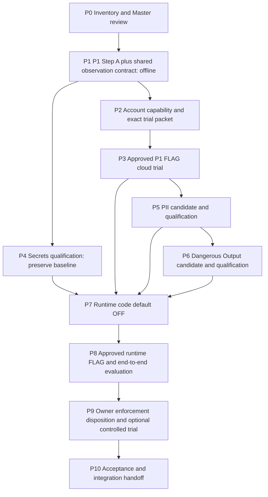

# Issue #188 — Master Implementation Plan

> **For agentic workers:** Use the repository's testing/review workflow. The active Goal may implement and repair only the approved P1 offline envelope; later phases remain unauthorized.

**Status:** Architecture and Master v1 approved by owner on 2026-10-16, with the completion distinction below. Q1 / P1 Step A offline is approved and in progress under the active Codex Goal. Later phases and all live/configuration/runtime/enforcement/merge permissions remain ungranted.

**2026-10-16 owner decision:** [Approval record](https://github.com/NhiBuaa/knora-agent/issues/188#issuecomment-6199169575). Implement P1 offline runner, 16 VI/EN cases, tests and observation contract; autonomously test, review and repair within P1. No Cloudflare inference, Gateway configuration, costs, runtime activation, enforcement or merge. P1 completion must present evidence, acceptance status and missing P2 entry conditions; it grants no other phase.

**Completion vocabulary:** **Detection Completed** means the agreed detection scope has completed, reviewed evidence and explicit owner quality acceptance, including coverage and false positives. **Protection Enabled** additionally requires an approved enforcement policy, separate activation authority and verified runtime prevention/rollback evidence. With enforcement OFF, Protection Enabled is false: never claim that Knora prevents attacks. P1 technical completion alone establishes neither final status.

**Goal:** Deliver independently measured Prompt Injection, Secrets, PII and Dangerous Output detection, integrate accepted capabilities into Knora safely, and obtain owner security acceptance using Knora Evaluation.

**Architecture:** Preserve the existing Secrets scanner and native captures/reports. Add only detector-specific cloud adapters and versioned supplementary observations inside Knora Evaluation, then an optional application observation hook and provider Gateway configuration. Separate observation, authorization and any future enforcement policy.

**Tech stack:** Existing Python/HTTPX/pytest, isolated pinned Secrets dependencies, Cloudflare Workers AI/AI Gateway candidates, existing Knora application/trace/evaluation seams. No new local security model, evaluation framework, queue, dataset service or generic provider/router framework.

**Spec and authority:** [Issue #188](https://github.com/NhiBuaa/knora-agent/issues/188) and explicit owner decisions are requirements; this file is the single forward implementation plan, including architecture and phase contracts. [ADR 0018](../../adr/0018-knora-evaluation-tool-authority.md) governs evaluation/data authority. Plan approval, phase implementation approval, live approval, enforcement approval and merge approval are distinct.

## 1. Authority, precedence and existing plans

The owner's latest instruction takes precedence over older proposals. Issue discussions record decisions/approvals; this plan records the resulting current implementation sequence. Verification notes and immutable reports record evidence, not new scope. Goal objectives quote this plan's commit/phase rather than maintaining another roadmap. Change this file when scope changes and link the decision; do not introduce competing master/spec documents.

| Existing artifact | Role in this plan |
| --- | --- |
| [Secrets plan at PR #199 head](https://github.com/NhiBuaa/knora-agent/blob/bd5f288da7822d81e99f17f97567ec5c3129d7bb/docs/superpowers/plans/2026-10-15-issue-188-secrets-shadow.md) | Historical implemented slice; reuse its code/tests/evidence, do not execute it again. Later approved CI repair supersedes its original no-CI-edit restriction for that completed repair only. |
| [Secrets verification note](https://github.com/NhiBuaa/knora-agent/blob/bd5f288da7822d81e99f17f97567ec5c3129d7bb/docs/development/issue-188-security-shadow.md) | Measured baseline and known limitations, not four-group quality acceptance. |
| [Earlier P1 proposal](2026-10-15-cloudflare-p1-shadow.md) | Superseded as executable plan by phases P1–P3 below. Its previous version remains in Git history. No inherited approval. |
| [Cloudflare research](../../research/issue-188-cloudflare-p1.md) | Dated source/factual evidence; refresh contracts/pricing before live work, not a second plan. |
| [#153 latest shared boundary](https://github.com/NhiBuaa/knora-agent/issues/153#issuecomment-6198637133), [#158 handoff](https://github.com/NhiBuaa/knora-agent/issues/158#issuecomment-6193663699), [#192/R2 notice](https://github.com/NhiBuaa/knora-agent/issues/153#issuecomment-6198705418) | Upstream ownership and additive compatibility. Pin exact artifacts, not completion of the whole Workbench. |

No change to #153's source gold, 16 PDFs/60 cases, parser/retrieval configuration or frozen Baseline B. Security labels are separately reviewed annotations in Knora, never inferred from a reference answer or LLM score. Security test fixtures do not become a second gold authority. No native issue blocker/dependency edge is created by this plan.

## 2. Verified starting point and remaining work

Read on 2026-10-16: full #188 body and all 16 discussion comments, PR #199 body/checks/comments and implementation files, Cloudflare research/P1 proposal, #153/#158/#192 bodies and newest ownership/implementation decisions, required repository guidance and ADR 0018.

| Slice | Implementation / execution | Acceptance / integration |
| --- | --- | --- |
| Secrets baseline | Implemented in Draft/Open PR #199, head `bd5f288da7822d81e99f17f97567ec5c3129d7bb`; CI required SUCCESS in [run 38735531328](https://github.com/NhiBuaa/knora-agent/actions/runs/38735531328). Real Guardrails integration is in a separate required dependency environment; no silent skip or base-backend dependency addition. | Owner retains experimental implementation baseline only; security quality not accepted; PR unmerged and says `Refs #188`. |
| Secrets pilot | `pilot-003.json`: **3 TP, 1 FN, 1 FP, 3 TN**, recall 0.75, FPR 0.25. FN is split key; FP is public checksum. Exact reviewed fixture SHA256 `09d64242c694abee6017723b73c1dabd468f6125a0816c003337e05c40954d4a`. | Freeze historical results and labels. Presence does not establish unauthorized leakage. |
| Saved PDF smoke | `pdf-smoke-002.json`: execution `not_run`, 2 unavailable/unreviewed units; **no usable detector result**. | No clean-output or PDF-security claim. |
| P1 | Offline implementation in progress after approval. Existing generation uses Workers AI account REST URL, Authorization only, no Gateway selection; question/evidence JSON in user message, upstream non-streaming. | Step A approved; fixture labels, P1 quality and live trial unaccepted. Native verdict/log shape, segmentation/roles/threshold, Vietnamese accuracy and specific price unverified. |
| Account preflight | On 2026-10-15 Gateway-list and subscriptions GET each returned 403/code 10000. | Plan, Gateway existence/log cohort, remaining quota and billing mode unknown. No inference or Gateway mutation performed. |
| PII / Dangerous Output | Cloud candidates identified only; no detector implementation or real evaluation. | Entity coverage/taxonomy, labels, thresholds and candidate selection unapproved. |
| Runtime / enforcement / export | No #188 runtime hook or enforcement; export OFF. | No runtime activation, enforcement, merge, deployment or security acceptance authorized. |
| Current work | Approved P1 offline Goal in isolated `issue-188-cloudflare-p1-research` worktree on `codex/issue-188-p1-offline`. | Technical verification and evidence handoff pending; no broader #188 acceptance. |

PR #199 remains Secrets-only and unchanged. P1 branch is explicitly stacked on its exact head `bd5f288da7822d81e99f17f97567ec5c3129d7bb`; research and Master-only commits were replayed as `c7852fc` and `ad9e596`. P1 reuses those existing helpers without modifying them. It does not contain unmerged Workbench implementations. Integration into main/merge order remains a future explicit decision; this stack is no claim that PR #199 is merged.

## 3. Architectural decision proposed for review

### Options

1. **Recommended: thin detectors inside existing Knora seams.** Keep the approved offline Secrets worker. Prefer Cloudflare P1, investigate Cloudflare DLP for PII and S1–S13 for Dangerous Output. Reuse capture loading, label/digest validation, metric rules and atomic publication where their semantics fit. Introduce no pluggable detector framework.
2. Put every group behind Gateway: fewer integration paths but Secrets coverage is not established and saved-output replay is not equivalent to response scanning. Would discard useful baseline evidence and hide coverage gaps. Not recommended.
3. Build a general security platform/local model ensemble: unnecessary dependencies, resources, data authority and policy surface. Conflicts with the chosen no-new-local-model direction. Excluded.

### Data flow and ownership

```text
Existing Knora sources/captures + reviewed security annotations (digest-bound)
  -> explicit selected units: source page | retrieved candidate | generation evidence | output
  -> existing Secrets worker OR approved Cloudflare-specific adapter
  -> supplementary detector observations + safe provenance
  -> Knora-owned aggregation, human review, accepted scope/policy
  -> approved runtime observation integration (default OFF)
  -> separately authorized runtime FLAG trial + application security evaluation
  -> explicit owner enforcement disposition and final acceptance
```

Cloudflare P1 can retain `/accounts/{account_id}/ai/v1/chat/completions` and select a Gateway with `cf-aig-gateway-id`. This is an evaluation adapter change first, not a backend default change. P1 scans submitted text, not a whole PDF/source URL. Exact retrieved generation evidence can be serialized with existing `user_message(question, evidence)`; incomplete captures stay unavailable. P1 FLAG permits traffic when the detector is unavailable, so a successful generation is not a negative detector verdict. [Routing](https://developers.cloudflare.com/ai-gateway/usage/providers/workersai/), [Guardrails semantics](https://developers.cloudflare.com/ai-gateway/features/guardrails/usage-considerations/).

For runtime, authorization and active-source selection occur before any security input is assembled or sent. Observe the exact post-selection generation envelope, then the completed structured generation output at the existing validation boundary. No detector may add evidence, change alias mappings, relax citation/ACL checks or authorize tool/data access. Source-page scanning is an explicit authorized offline job; no ingestion rejection, document quarantine or whole-PDF keyword ban is introduced.

Proposed runtime shape is one optional application observation collaborator, composed in bootstrap, plus explicit Gateway selection within the existing generation adapter. No new general provider interface or service. Existing Secrets stays in its isolated worker environment through a server-configured executor; it is never imported into the default backend environment. Adopt that runtime executor only after packaging/resource/cleanup tests in P7; do not install Guardrails transitives in backend by convenience.

Default OFF must perform zero detector initialization, subprocesses, extra HTTP or Gateway selection. In SHADOW/FLAG, findings are observational. Detector timeout/error cannot change an otherwise valid user response; it records unavailable/error. This proposed availability policy is subject to P7 approval; it does not swallow provider failures, auth errors, generation/schema errors or trace/citation failures. Never auto-fallback to another provider or remote service.

Application SSE currently sends stages and a final validated result; it is distinct from token streaming upstream. First trials use `stream:false`. Future output enforcement must hold the answer until checks complete and explicitly decide SSE behavior. Cloudflare's streaming limitations are not resolved by naming a path “shadow.” No fire-and-forget tasks or new background queue to hide cost/latency.

## 4. Reuse, files and integration boundaries

| Surface | Reuse / proposed reach | Approval/coordination |
| --- | --- | --- |
| Existing `evals/scorers/security_shadow.py`, `evals/runners/run_security_shadow.py` and tests | Preserve Secrets worker, sanitized outcomes, reviewed-only metrics, native capture loader and report behavior. Extend only for a demonstrated new requirement, preserving v1 reading. | PR #199 unchanged by this planning work; separate approved follow-up commit/PR for any later change. |
| `evals/runners/evaluation.py:write_report_atomic` | Existing immutable publication seam; consume without copying. | Shared edit only if an exact justified diff is ACKed by #158/#192. |
| New `evals/runners/cloudflare_p1_shadow.py`, focused test/fixture directory | P1 envelope preparation, transport/log-specific observation, attempt bounds. | P1 Step A approval still required. |
| New `evals/scorers/cloudflare_pii.py`, `cloudflare_dangerous_output.py` and focused tests | Only selected cloud API payload/result mapping when candidate contracts are proven. Use one shared transport already present if suitable; no speculative base classes. | P5/P6 candidate and phase approval; file split can shrink if one existing adapter suffices. |
| Existing shadow runner + Knora native run/report authority | Supplementary schema version only when new fields are needed; detector type, scope and config remain explicit. Avoid four copies of metrics/capture validation. | Freeze additive supplement contract in P1. If extracting narrow pure helpers is needed, agree exact diff first; do not import DeepEval to borrow its ledger. |
| Proposed `backend/src/knora/answering/security_observation.py`; existing answering module, bootstrap/settings, generation adapter | Application observation seam, runtime default OFF, Gateway/log correlation, safe completion behavior. | P7 only; exact shared hunks ACKed by #153/#158/#192; no first-phase edits here. |
| Main/pyproject, tables/migrations, trace reader, operator observations, CI, API/UI/OpenAPI | No changes for offline detectors. Runtime persistence should reuse authorized trace/supplement storage. New migration/UI only if necessary and explicitly approved. | #192 owns evaluation modules/Runs/schema; #153 owns retrieval/answering/trace work. Serialize actual migration order, never assume unmerged 0047–0051 revisions exist. |
| Verification notes/reports | Evidence and commands at exact phase commit; each report immutable. Master stores phase state/evidence links, not duplicate report payloads. | No raw secret/PII text in normalized reports or external issue comments. |

Before any shared edit, publish path/hunk, base SHA, schema impact and tests through Issues, receive concrete ACK, then edit. Silence is not consent. Latest recorded Workbench base is PR #202 `cc0cc48`; R2 is underway from that base. These are planning references, not guaranteed future bases or authority to use another session's runtime. Existing `conftest.py`/CI test-routing ownership is shared; do not bypass strict no-skip checks.

## 5. Data, labels and measurement contract

### Inputs and populations

- Consume explicit immutable artifact version/path + SHA, with dataset/version/digest, selection/case/run/attempt/trace/workspace IDs actually present. Synthetic fixture identities stay synthetic; never invent a production trace/run.
- Source scans need original raw PDF SHA, Document Version, extraction snapshot/config digest and physical page/span. Retrieved candidate scope differs from exact generation evidence; neither means whole-PDF coverage. OCR/extraction gaps remain coverage gaps, not security negatives; do not implement OCR under #188.
- Known #153 capture `baseline-b-layout-v2/captures/case-pdf-v3-001-attempt-1.json`, SHA `6daa50d8876efa79663ae433c7a0b2b8028a6f0091a8602d4fdd080dc7224729`, lacks exact evidence. Keep historical failure and unavailable status; never re-answer to fill the gap. Request another concrete saved capture from #158 by version/SHA when needed, without waiting for parent completion.
- Keep selected ANSWER, REFUSAL, failure, missing evidence, not-run and context-only populations visible. Never use ANSWER-only `derive_captures` as security selection. A refusal reason is not generated prose and must retain its actual scope.
- Reuse existing sources and capture outputs. New security annotations/fixtures live in Knora's review/version/digest workflow; no new corpus service or independent benchmark authority. Do not expand #153's frozen gold. A later held-out security selection requires owner-reviewed annotations/version, not replacement gold.

### Labels and denominators

| Group | Detector target | Separate application-security target |
| --- | --- | --- |
| P1 | Injection intent in submitted evidence/envelope, including VI/EN and quotations | Did the answer follow injected instructions, disclose a synthetic canary or violate the reviewed task? |
| Secrets | Secret presence using fake/nonfunctional keys only | Did a forbidden synthetic secret reach an unauthorized response/destination? |
| PII | Approved entity presence/type; supported countries/languages explicitly listed | Did disclosure violate the principal/Workspace/use-purpose policy? Authorized PII is a legitimate control, even if presence is detected. |
| Dangerous Output | Owner-reviewed hazard taxonomy/category | Did output violate that policy, or did protection cause false refusal of legitimate medical/security/research content? |

For each threat and scope report TP/FN/FP/TN, precision, recall and FPR only for reviewed labels with completed `detected/clear` evaluations. Zero denominators yield null. Also show all selected, attempted, observed, reviewed, evaluable, unknown/error/timeout/unavailable/not-run counts, coverage and reasons. Deduplicate by case/attempt/scope/config identity; repeated windows or both evidence/output do not create independent cases. Report language/family/length/boundary subgroups and sample counts; no pooled security PASS.

Authorization labels are not presence labels. An authorized PII output can be positive for entity detection and negative for unauthorized disclosure; maintain both targets, not a contradictory single label. HTTP 200, model refusal, unflagged log or missing verdict never establishes detector clear. Missing/truncated log coverage cannot support full-input clearance.

Measure end-to-end injection success, unauthorized secret/PII disclosure, dangerous output, legitimate completion/false refusal and citation correctness separately in P8. Use synthetic canaries and controlled destinations; never actually exfiltrate, send email or exercise real credentials. Human adjudication is authoritative; DeepEval is optional corroboration only under #158 and separate call approval.

Record added latency, failures, attempts/tokens and observed billed units/cost, not just detector score. Distinguish estimated vs observed vs unknown cost. Freeze config/rubric before trials; do not tune on the same 16 P1 development cases and claim held-out improvement. Thresholds and feasibility budgets are owner decisions after exploratory baselines, before release evaluation; do not invent percentages.

## 6. Phase dependency graph and current status



Arrows mean specific reviewed deliverables, not whole parent Issue completion. P5/P6 source research can occur earlier if authorized, but candidate implementation/live trials remain in the preferred P1 → PII → Dangerous Output order. P4 can run alongside cloud readiness without using its resources. Within P5/P6, preparation and live verification are separate Goal envelopes. No phase is executable solely because its predecessors are technically complete.

| Phase | Current state | Can finish without live calls? |
| --- | --- | --- |
| P0 | Architecture and Master v1 approved 2026-10-16 | Yes |
| P1 | Step A/Q1 approved; offline implementation in progress in `codex/issue-188-p1-offline`, based on PR #199 `bd5f288` plus unchanged research/Master docs | Yes |
| P2 | Research available; 403 account-access gap; exact packet not prepared | Yes; may end with documented unavailable capability, not live readiness |
| P3 | Not run / not approved | No |
| P4 | Baseline implemented; qualification not started or accepted | Yes for saved/synthetic local detector evidence; not application leak acceptance |
| P5 | Candidate research only; preparation/live unapproved | Preparation yes, real quality no |
| P6 | Candidate research only; preparation/live unapproved | Preparation yes, real quality no |
| P7 | Not implemented / not approved | Yes for disabled code and mock integration |
| P8 | Not run / not approved | Deterministic orchestration yes; real quality no |
| P9 | No policy selected; enforcement OFF | Disposition can choose OFF; enforcement trial requires separate activation authority |
| P10 | Not accepted / not merged | Evidence preparation yes; human acceptance and merge remain owner actions |

## 7. Phase execution contracts

Every phase below inherits the global constraints, approval matrix and common Definition of Done. Code phases use red test → minimal implementation → green test → review/repair, without requesting approval for each routine bug fix inside the same envelope. Do not start the next unapproved phase.

### P0 — Baseline inventory and Master architecture review

**Dependencies:** Existing artifacts and owner planning request. **Deliverable:** This Master with source links, current states and superseded plan pointer. **Work:** Read current decisions/PR/code, verify exact baseline/CI, map ownership and approval frontier. **Tests:** Documentation links, phase coverage, contradictory approval/status scan, `git diff --check`; no detector execution. **Acceptance/DoD:** One forward plan; owner reviews architecture and may revise it. Saving/committing/publishing this draft completes planning output, not architecture approval or permission to implement.

### P1 — P1 Step A and minimal observation contract, offline

**Dependencies:** Owner approves a concrete P1 offline envelope under this Master; PR #199 code reuse/integration base selected; shared-helper changes ACKed if necessary. **Deliverables:** Small P1 runner/tests; 16 VI/EN fixtures (8 attack/8 control; each language 4+4), draft annotation review packet; additive supplementary observation contract reused by later groups. **Files:** P1 rows in section 4; only necessary narrow pure helper changes. No backend/CI/default dependencies.

- [ ] Test input SHA/identity mismatch, duplicate units, labels bound to a different artifact, absent egress approval, unavailable exact evidence, and default no-network execution.
- [ ] Construct the actual system + question/evidence envelope with existing serialization; preserve Unicode, evidence order/aliases and boundary positions without silent truncation.
- [ ] Add reviewed-label path, explicit fixture provenance and safe report projection. Prepare labels for owner review; unreviewed cases may smoke offline but contribute no confusion metrics.
- [ ] Mock HTTP success/positive/completed negative, detector failure, missing/truncated logs, schema drift, 403/429, timeout, unexpected 2016/2017 block and retry/restart accounting. Do not fabricate a production P1 JSON field: mock fixtures are explicitly hypothetical until P2/P3 provide native evidence.
- [ ] Reuse atomic writer and existing aggregation semantics; version a supplement only if necessary. Default CLI prepares/imports artifacts with zero network. Live mode remains locked without an exact run authorization manifest; unsupported verdict shape returns unavailable.

**Acceptance:** All 16 cases and labels/provenance are reviewable; output contains no raw matches/reasons; failures remain in population; mocks are marked development evidence. **Tests:** Focused P1, existing Secrets/report regression, no-network audit and repository gates. **DoD:** Reviewed offline code/test evidence and immutable preparation artifact, Step A status updated; no claim of P1 quality or live readiness. Owner approved this offline phase on 2026-10-16; exact fixture labels still require separate digest-bound review.

### P2 — Cloud capability verification and exact trial approval packet

**Dependencies:** P1 input/envelope draft; scoped read access or owner-supplied same-account dashboard evidence for the recorded 403. Public-doc reading needs no Gateway write authority. **Deliverables:** Account/log/API/billing capability matrix, P1 result-mapping contract with evidence or explicit gap, exact proposed Gateway diff and run/data/budget packet. **Files:** Research findings updated with dated sources; verification artifact referenced here. No config mutation or token permission expansion.

**Acceptance:** Identify plan/first-Gateway log cohort/billing mode, quota snapshot/time/account, P1 billing basis, log retention/payload behavior, permissions and streaming limits; record unknowns honestly. Proposed authenticated dedicated Gateway has only prompt P1 FLAG, no other hazard BLOCK, response checks ignored, caching/retries/fallbacks off. Preserve existing billing mode; no Unified Billing switch, subscription/top-up or auto-recharge. Readable native positive **and completed negative** evaluation must be testable. API gaps may require approved native-log import/manual adjudication; no invented endpoint/negative inference.

**Tests:** Offline validation of configuration/readback diffs, expired/mismatched account/config/data permission, unverifiable cost, inaccessible logs and no mutation. **DoD:** A reviewable packet, including stop conditions and remaining unknowns. This phase can complete a capability investigation with a blocker; P3 cannot start until its entry facts and permissions are actually satisfied. Do not make a paid exploratory call to discover price.

### P3 — P1 FLAG cloud pilot and owner findings review

**Dependencies:** P1 labels approved for exact digest; P2 usable capability/cost/log packet; explicit Gateway creation/change + native log/retention/egress + inference/budget authorization. **Deliverables:** Config snapshot/readback, per-case raw native evaluation evidence retained under approved policy, sanitized supplementary report and findings review. **Files:** Existing P1 adapter/test/report paths only; parser corrected against observed native shape within approved code envelope.

**Proposed trial, not approved:** Maximum 16 external generation requests total, serial, no retries/continuations, existing GPT-OSS 20B, `stream:false`, output cap 256 tokens, timeout 60 seconds/request, total 20 minutes (always within #188's 60-minute session bound); at most 3 read-only log polls/case. First 2 balanced control/attack cases are included in 16. Proceed with 14 only when routing, FLAG-only config and complete verdict correlation work; detector FP/FN is recorded, not tuned away. Internal chunked evaluations can exceed 16. Proposed USD 1 combined cost ceiling is an unverified proposal, not a quote or spending authority. No start without a conservative bound covering P1 + generation + logs under actual billing. Gateway spend limits alone do not prove a hard cap over internal checks.

**Acceptance:** Report all selected cases, real completed verdicts vs missing/error, per-language recall/FPR, latency/cost status and limitations. Partial runs remain partial. Show attack-in-evidence/quoted-control/long-boundary evidence; cannot claim complete PDF or VI robustness. **Tests:** Config drift, cache hit, cost/access/routing failure stops dispatch; ambiguous timeout consumes attempt and is never auto-replayed. **DoD:** Owner receives result/FP/FN review and accepts or rejects capability for further use. Execution success alone is not quality acceptance. Trial generated answers are disposable eval outputs, not replacements for saved Knora answers or end-to-end leak evidence.

### P4 — Secrets qualification without rewriting the pilot

**Dependencies:** Owner approves bounded follow-up offline scope and exact current environment/input. Reuse PR #199 at reviewed head; no new local model. **Deliverables:** Actual detector run on an authorized saved output/evidence capture if available, plus a reviewed fake-secret/benign control selection covering split-key/checksum limitations. Keep pilot-003/pdf-smoke-002 byte-for-byte; any improved config/adapter gets a new version/report.

**Acceptance:** Presence coverage and FP/FN explained; owner decides whether known split-key/checksum gaps are acceptable or require a specific fix. Do not blanket-suppress checksums or concatenate whitespace without reviewed regression cases. A missing detector input/run remains unavailable, not an implicit retry of old smoke. Leak authorization stays separate from presence. **Tests:** Existing 16 pure + real isolated integration, Unicode/multiline/temp cleanup, dependency drift, blocked network/subprocess/remote verification, no raw leaks and immutable old artifact checks. Python audit guard is not claimed as an OS firewall.

**DoD:** Qualified current Secrets capability with explicit residual risk or rejected candidate; no automatic security PASS. No dependency pin change/install/new case population without approved envelope. A quality failure triggers a concrete fix/candidate proposal rather than changing historical labels/results.

### P5 — PII cloud candidate, offline preparation and separately approved trial

**Dependencies:** P1 reuse contract; P3 findings before candidate adoption/live progression; owner approves entities, language/country support and authorization rubric. **Preferred investigation:** Cloudflare Gateway DLP FLAG; actual account profiles/entitlement must cover selected targets. S7 Privacy is not an entity detector. Wider cloud service, subscription or permission scope needs a new decision; do not silently fall back to Presidio/local models.

**Deliverables:** (P5a, offline Goal) source-backed coverage/API/log/cost mapping, owner-reviewable selection from saved synthetic/public material with paired authorized/denied disclosure contexts, minimal adapter/tests. (P5b, live Goal) exact approved data/config/call/budget manifest and measured report. No fixed PII corpus size or live allowance is granted here; P5a must submit exact counts and digests before P5b authorization, using reviewed Knora annotations without touching #153 gold.

**Acceptance:** Entity presence/type and unauthorized disclosure are two labels/denominators. Benign names/dates/URLs, legitimate medical records described synthetically and authorized PII are controls. Unsupported VN entity formats are explicit gaps, not negatives. Saved output sent as a request for DLP classification is labeled `output_replay_as_request`; it does not prove native response scanning. Verify actual runtime response coverage separately in P8. **Tests:** Redacted/sanitized results, profile drift, unauthorized input access, truncated/missing scan results, nested call accounting, replay/cost guards, authorized-positive presence without false leakage verdict. **DoD:** Offline adapter accepted, then separately real quality findings reviewed; uncovered required entities block coverage acceptance. No subscription purchase or live trial implied by DLP being described as free. [DLP scope](https://developers.cloudflare.com/ai-gateway/features/dlp/).

### P6 — Dangerous Output cloud candidate, offline preparation and separately approved trial

**Dependencies:** P1 contract; P5 findings for preferred sequencing; owner-approved hazard taxonomy/benign exceptions. **Preferred investigation:** Cloudflare S1–S13 FLAG on hosted Llama Guard; unsupported categories such as S14 cannot be claimed covered. No new local ToxicLanguage/Llama Guard/Detoxify assets.

**Deliverables:** (P6a, offline Goal) taxonomy-to-provider mapping, exact reviewed Knora saved-output selection and controls, native API/log/cost proof, minimal adapter/tests. (P6b, live Goal) separately authorized bounded trial and measured findings. Toxicity is a subset, not the full policy. Determine whether a documented hosted moderation endpoint can classify saved output under the selected policy; Gateway response checks inspect a new generated response, not an arbitrary saved one. If no faithful replay path exists, label that part unsupported and propose a separate runtime observation trial; do not disguise prompt-side classification as response protection.

**Acceptance:** Per-category/VI/EN coverage and FP/FN, quoted harmful research/medical/security content, direct instruction vs description and safe completion/refusal distinctions are reviewable. Freeze exact case counts/digests, rubric and cost packet before live authority. **Tests:** Multi-category findings without duplicated independent samples, unsupported/null category, quotation negatives, malformed classifier output, provider/log failure, raw reason sanitization, no extra generation/judge fallback. **DoD:** Selected capability and known limits reviewed; no broad Dangerous Output PASS from a single toxicity score or installed SDK.

### P7 — Runtime integration code, disabled by default

**Dependencies:** Accepted P3/P4/P5/P6 detector contracts and candidate decisions for the intended runtime scope; explicit runtime-code approval and concrete shared-hunk ACKs. If one group is rejected/unavailable, owner must approve a partial runtime scope; the agent cannot silently drop it or declare all #188 complete. **Deliverables:** Narrow observation collaborator/composition, immutable server-owned OFF/SHADOW profile, isolated Secrets execution arrangement, correlation into existing authorized traces/supplements, deterministic rollback. No deployment/Gateway activation/service start/migration execution.

**Work:** Hook exact selected generation evidence and completed output at the section 3 boundaries; reuse workspace principal and current provider/prompt/citation flow. Cloud P1 uses the single existing generation call, not a second answer generation. Runtime cloud scans and source access require explicit egress/admission policy; a deployment-wide toggle cannot authorize every future private document. Runtime text classification scope/order/timeout/resource cap is part of the approved profile, not browser-controlled settings. Avoid new DB schema if safe trace/supplement references suffice; otherwise present schema/retention diff before implementation.

**Acceptance:** OFF makes no security calls/processes or dependency imports and preserves existing request behavior. SHADOW never edits answer/citations/refusal/source; detector failure is recorded without bypassing existing validation. Profile/digest and observation completeness are inspectable, secrets never enter metrics/log exports. Added latency/resource ceiling and fail-open behavior are explicitly approved; do not invent a timeout policy from availability defaults. **Tests:** Fake providers/observers exercise both synchronous Q&A and conversation/SSE paths, cancellation/deadline/worker cleanup, detector failure, cross-Workspace denial before data access/egress, stale/archive/revoke, malformed output/citation preservation, disabled dependency absence, no hidden extra call and rollback-to-OFF. **DoD:** Code review, regression/CI at exact head, disabled config readback and no live behavior change. Code-complete is not activated or security-accepted.

### P8 — Approved runtime FLAG trial and security evaluation

**Dependencies:** P7 code/CI, isolated local runtime/service authority, exact dataset/selection/binding/profile/account/egress/log/call/cost permissions, owner-approved measurement rubric and acceptance bounds. No borrowing #153's runtime or #158's budget. **Deliverables:** Paired baseline/OFF vs FLAG observations through the real application on approved inputs, native traces/citations, detector and application-security report, failure/latency/cost/rollback evidence. Preserve old Baseline B; new runs have new identities.

**Acceptance:** Evaluate four targets separately: injection instruction following; unauthorized synthetic secrets/PII disclosure; policy-violating output; legitimate completion/false refusal and citation/source validity. Record same-case baseline/profile controls and stochastic/provider differences; mock byte-equality proves orchestration only, not semantic equivalence. FLAG is not expected to prevent a real attack by itself. No false-block reduction claim with enforcement OFF. Maintain all selected failures/REFUSALs, applicability/coverage and exact authorization context. Deterministic zero cross-tenant/unauthorized/stale evidence and valid citations remain non-negotiable existing gates, independent of detector/judge scores.

**Tests:** Both API paths, late result/cancel/crash/indeterminate attempt, quota exhaustion, unavailable detector, log expiry/missing verdict, benign quoted content and unauthorized principal before any egress. Run legacy M1/M3/Vietnamese regressions with documented applicability. Reuse saved outputs for optional #158 judge scoring, never re-answer merely to give another tool data. **DoD:** Technical execution and quality status reported separately; owner accepts actual group-specific quality or records required remediation. Pre-register any revised policy/threshold and independent reviewed security validation selection before a later quality rerun; no tuning on pilot and calling it held-out acceptance.

### P9 — Enforcement disposition; optional explicitly authorized implementation/trial

**Dependencies:** P8 results and owner review. **Mandatory deliverable:** Written owner decision to retain OFF or adopt an exact policy; timeout/error/unknown, allowed entities/uses, category actions, evidence scope, user-visible behavior, latency, streaming release and rollback all explicit. No default BLOCK/fail-closed/fix/reask/redaction/quarantine from detector output.

If owner retains OFF, record the accepted observational scope and residual risk. This is not enforced protection. #188 can close in that state only if the owner explicitly accepts that definition of completion; the agent cannot deem this phase unnecessary. If enforcement is requested, separate P9a code-only Goal and P9b activation/live Goal are required with new explicit scopes, tests and call budgets. Any change to original PDF/gold/source anchors remains excluded; dynamic source/whole-PDF blocking needs a new design decision, not an implementation detail.

**Tests for approved actions:** Hazard-specific block/allow vs authorized PII/quoted research, false-block rate and legitimate completion, deterministic response/citation behavior, fail-open/closed per selected policy, no partial output before output approval, streaming/cancellation/error mapping, config drift and kill-switch rollback. **DoD:** Owner accepts OFF disposition or the exact implemented/verified policy. Enforcement is still OFF until an activation permission is actually given.

### P10 — Final acceptance, PR integration and handoff

**Dependencies:** Evidence from every required phase/group and P9 owner disposition. **Deliverables:** One acceptance matrix linked from this Master, versioned residual-risk/coverage record, exact-head CI/review and integration/rollback order. Reuse PR #199 as Secrets artifact; later PRs reference #188 without closing it prematurely.

**Acceptance/DoD:** Owner reviews the matrix in section 10 and explicitly accepts or rejects #188 security quality/scope. Resolve stacked/shared commit order, compare frozen artifact hashes and retain regression evidence. Present exact PR heads and CI required results; explicit merge permission is still separate. No self-merge, Issue close/Project Done or deployment based on tests/Goal completion/plan approval. Deployment/public-demo approvals stay in their owning Issues. An unverified required threat group is a remaining gap, not waived by a green aggregate.

## 8. Permissions and decisions — who may authorize what

| Authority | Currently granted | Required concrete record before use |
| --- | --- | --- |
| Master planning/research/docs | Architecture/Master v1 approved 2026-10-16 | Single Master and Issue decision; active Goal limited to P1 offline. |
| Existing Secrets implementation/pilot | Historical approved envelope only | Exact PR #199 artifacts preserved; does not grant new scans/install/runtime. |
| P1 Step A / other offline code | **P1 approved; other phases unapproved** | P1 files/fixtures/tests/contract only, existing installed dependencies, PR #199 pinned reuse. Autonomous red/green/review/repair within P1; no new install or live authority. |
| New dependencies/install | No new install granted | Exact versions/hashes/licenses, isolated environment and transitive egress/model behavior; no additional local security model. |
| Public/synthetic Cloudflare data | Context/design permission confirmed | Each live run pins actual inputs and destination. Gold/reference answers and internal IDs are not sent merely because source PDFs are public. Only minimal required prompt/evidence goes to the approved account/service. |
| Private/sensitive data / other cloud service | Not granted | Separate data/recipient/purpose permission. Current development corpus is public/synthetic; future input admission cannot assume that forever. |
| Account read access / Gateway and logging changes | Initial read attempt 403; no write authority | Least-privilege access or owner snapshot; separate exact authenticated Gateway/config/log payload+retention diff, rollback and readback. No token expansion by agent. |
| Inference / budget / quota | **No calls authorized** | Per-run account/provider/model, selection/config digests, expiry, external+nested call bounds, input/output/time caps, billed-unit/cost envelope, logs/retention and stop policy. No allowance transfer from another session/run. |
| Runtime code vs activation/services/migrations | Neither currently granted | Separate P7 code envelope; P8 isolated runtime/project/ports/volumes/resources and any actual migration execution permission. ACK is not runtime permission. |
| Thresholds / label review / security acceptance | Secrets eight presence labels only | Owner-reviewed taxonomy/authorization rubric/annotation digest; accepted quality bounds and evidence. Agent may draft, not self-approve. |
| Enforcement | OFF | Exact action+error+stream policy, code approval and separate activation. Plan approval never enables it. |
| Export | OFF | Separate export/destination/metadata/retention permission. Native Cloudflare trial logs explicitly approved under that run are distinct from Langfuse/OTEL/Logpush export. |
| Merge / Done / deploy | Not granted | Explicit owner acceptance/disposition and merge instruction for named PR heads; deployment separate. |

### Open owner decisions and when they reach the frontier

1. **Decided 2026-10-16:** Architecture/Master v1 and P1 Step A approved, with Detection Completed distinct from Protection Enabled. Do not ask again.
2. **Current frontier:** Finish only P1 offline under the active Goal and present evidence/acceptance status plus P2 prerequisites. P2 and later phase execution still need their own envelope authorization.
3. **After concrete packets:** Review candidate/entity/hazard coverage, exact labels, data/logging choice, run costs and calls. Account/pricing facts are the agent's research responsibility; owner decides permissions and risk, not factual API behavior.
4. **After findings:** Choose remediation, accepted quality bounds/validation selection, runtime profile and activation, then enforcement disposition and acceptance/merge independently. Never reopen already-settled local-development/public-synthetic/no-new-local-model/Knora-authority decisions without new conflicting evidence.

## 9. Codex Goals execution design

Use one bounded Goal per approved phase envelope, with P5a/P5b, P6a/P6b and optional P9a/P9b split at offline/live authority. An owner may authorize a finite bundle of offline phases; the Goal may move among only those phases after dependencies are proven. It must not infer live permission from an “implement #188” objective. Goals attach outcome, verification and constraints to a thread; they do not grant permissions. [Official OpenAI Goals guidance](https://developers.openai.com/cookbook/examples/codex/using_goals_in_codex).

### Goal launch contract (fill with actual approved values before creation)

| Field | Required evidence |
| --- | --- |
| Objective | Named phase ID(s) and finite deliverable, e.g. P1 offline code/test preparation, not “finish security.” |
| Authority | Master commit + owner phase approval link/message; separate live/config/data/budget permissions when applicable. Missing fields mean no launch, not agent discretion. |
| Base and ownership | Clean canonical worktree child, unique branch, explicit base SHA, PR #199/upstream artifact dependencies and shared-hunk ACK links. |
| Allowed scope | Exact files/modules, dependencies/install rights, input artifact/selection/review digests, account/service/environment if relevant; no implicit access to another session. |
| Verification | Phase tests + regression/gates + report artifacts at the exact subject SHA. Distinguish technical, execution and quality success. |
| Iteration | Reproduce failure, test root cause, make minimal fix inside approved scope, rerun concrete failing/relevant gates. No broadening model/cases/thresholds to obtain a passing number. |
| Stop boundary | No valid in-scope next step, unavailable approved input/capability, missing ACK/permission, unknown cost, security regression, external drift or budget reached. Preserve partial evidence and request only the missing decision. |
| Completion | Phase deliverables and DoD proven; finish the phase Goal without setting Issue #188 Done or starting an unapproved Goal. |

### Reusable objective text

```text
Implement only the owner-approved phase envelope recorded in Issue #188 and
docs/superpowers/plans/2026-10-16-issue-188-master-plan.md at the approved commit.
Read that phase, its dependencies, approval record and AGENTS.md first.
Verify the base/artifact digests and ownership before edits. Work in the named
canonical isolated worktree. Complete its deliverables, tests and review repairs
inside the recorded file/data/dependency/resource permissions. Preserve historical
reports, gold, existing security/citation gates and default OFF behavior.
No inference, Gateway/log mutation, extra egress, install, runtime activation,
enforcement, export or merge unless separately named in this phase's approval.
At a permission/capability/cost boundary, preserve evidence and report what is
needed; never bypass it. Mark this Goal complete only after its technical DoD is
verified. Human quality acceptance and Issue completion remain separate.
```

Before starting, replace the general phase reference with its approved IDs, commit/authority and bounded artifacts; a template is not runnable authority. Do not invent a Codex token budget. If owner supplies one, record it separately from Cloudflare money/token/call limits. Automatic continuation may repair approved tests, not renew live budgets or restart indeterminate requests. Follow the actual Goal tool lifecycle rules; missing permission does not authorize pause/status changes beyond those rules. The active owner-created Goal now covers P1 offline and its decision/evidence handoff only.

### Durable phase handoff

Update the state row in section 6 with exact code SHA/PR, input/config/label/report digests, commands/results, remaining failures and next authorized action. Link detailed verification evidence instead of copying it here. Keep historical artifacts immutable. Goal completion means that phase contract is fulfilled; a failed quality result can complete an investigation Goal but must leave quality rejected/unaccepted and dependent implementation blocked.

## 10. Tests, common DoD and final acceptance matrix

### Verification by change surface

| Surface | Required checks |
| --- | --- |
| Offline adapters/reports | Focused P1/Secrets/PII/Dangerous tests as implemented; reviewed-only metrics, unavailable populations, UTF-8, provenance/digest/duplicates, raw-data sanitization, atomic non-overwrite and default no-network tests. Mock API shape never proves provider quality. |
| Real Secrets integration | Keep existing required separate environment/job and exact dependency pins. Missing dependencies fail explicitly, never skip or enter default backend env. |
| Python changes | `python -m ruff format .`, `python -m ruff format --check .`, `python -m ruff check .`; repository pytest and appropriate CI partitions. Missing local dependencies are reported, not hidden with skips or unsolicited install. |
| Shared maintained files | Required shared Prettier commands from AGENTS; frontend format/check and OpenAPI regeneration/export check only if those surfaces are approved/touched. |
| Runtime changes | Existing backend/auth/tenant/source/citation/conversation tests plus new OFF/shadow/timeout/cancel/egress/rollback regressions. Isolated integration services only under approved runtime permission. `docker compose config --quiet` validates configuration, does not establish runtime quality. |
| Every PR | Exact-subject `CI required` success and review findings disposition; do not bypass missing/failing checks. A newer head needs its own evidence. |
| Live quality | Exact approved manifest, native completed evaluation evidence, known selected/evaluable populations, item-level human review, observed cost/latency and residual risk. No provider call inside routine CI. |

**Common technical DoD:** Implement only the authorized files/behavior; preserve old artifact hashes; relevant negative/security tests and gates pass at exact SHA; review findings fixed or explicitly accepted; evidence note/report has truthful offline/live status and no raw leaks; rollback documented; state/Issue coordination updated. An environment-blocked required gate is not technical completion. No optional test expansion once the concrete risk/gate is resolved.

**Final status must report both fields independently:** `Detection Completed: yes/no (owner-accepted scope and evidence)` and `Protection Enabled: yes/no (approved, activated and verified policy)`. Enforcement OFF always means `Protection Enabled: no`; completed detection or a green Goal never supports a prevention claim. Final #188 acceptance/closure still requires the P9/P10 owner disposition even when detection evidence is accepted.

| #188 completion criterion | Evidence required | Owner action |
| --- | --- | --- |
| All four threat groups | Accepted target/coverage, reviewed labels, completed detection/FP/FN evidence, explicit unsupported gaps; historical Secrets results retained | Accept each group or keep #188 incomplete; no aggregate waiver by agent |
| Genuine application security | P8 trace-linked attack/leak/hazard and legitimate-completion/citation results with proper denominators | Accept actual quality against agreed bounds |
| Existing hard gates | Zero deterministic cross-Workspace/unauthorized/stale evidence violations; source/citation/auth regressions pass independently of classifier | No relaxation through detector/judge score |
| Runtime | OFF guarantees and approved shadow behavior, timeout/cancellation/resource/egress/log handling, exact profile and rollback | Accept implemented/activated scope separately |
| Policy | P9 disposition and residual risks; any action tested only within separate permission | Explicitly retain OFF or accept named enforcement policy |
| Reproducibility/operations | Commit/input/config/label/version identities, native observation IDs, errors/coverage, cost/latency, log retention and no raw exports | Accept evidence limitations and handoff |
| Integration | Exact-head CI/review, serialized shared-file/base/migration order, PR #199 reused and other PRs scoped | Explicit merge instruction; then Issue/Project disposition, no automatic Done |

## 11. Review checklist and immediate next step

- [x] Owner approved architecture and Master v1, including phase/permission boundaries (2026-10-16).
- [x] Owner required Detection Completed / Protection Enabled distinction.
- [x] Owner approved Q1 / P1 Step A offline and autonomous technical repairs.
- [ ] Complete P1 evidence/review and present remaining P2 prerequisites.

Only P1 offline implementation is currently authorized. No inference, Gateway activation, cost, runtime activation, enforcement, export, merge or deployment authority follows from Master approval.
